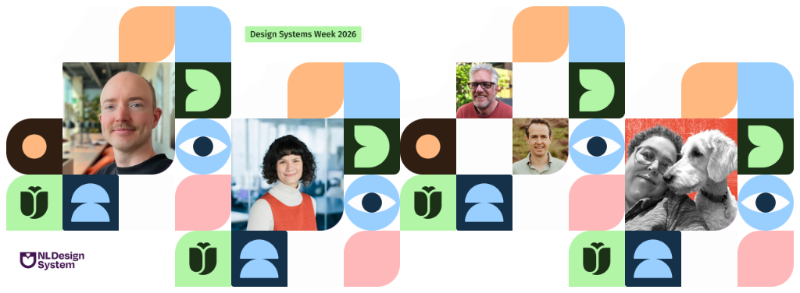

# Design Systems Week voor developers

[NL Design System](https://nldesignsystem.nl) organiseert in 2026 voor de 5e
keer de Design Systems Week. Van 26 tot en met 29 oktober zijn er dagelijks
meerdere korte sessies van diverse organisaties online te volgen over het hoe en
waarom van design systems.

Natuurlijk zijn alle sessies superinteressant, maar er zijn ook een aantal
sessies die speciaal interessant zijn voor (front-end) developers. In dit blog
zet ik paar sessies op een rijtje.

<!-- truncate -->

## Een paar sessies uitgelicht

### [Tracking conformance data within the code-base](https://nldesignsystem.nl/events/design-systems-week-2026/programma#tracking-conformance-data-within-the-code-base)

> Maandag 26 oktober 13:00 | Dr Steph Driver - Open Library of Humanities

Deze sessie gaat in hoe je toegankelijkheidsaudits rechtstreeks integreert in je
eigen codebase. Dit vormt de basis voor een continu proces van gerichte
toegankelijkheidsaudits en verbeteringen, in plaats van te vertrouwen op audits
die slechts eens in de paar jaar plaatsvinden. Ben je geïnteresseerd in het
verbeteren van workflows rondom toegankelijkheid, dan raad ik je aan om deze
sessie te volgen. **Goed te weten:** Deze sessie is in het Engels.

### [Digitale toegankelijkheid van kaartviewers](https://nldesignsystem.nl/events/design-systems-week-2026/programma#digitale-toegankelijkheid-van-kaartviewers)

> Maandag 26 oktober 2026 om 15:00 | Eric van Mullekom - Kadaster & Maarten
> Schut - Kadaster

We hebben op developer.overheid.nl al eerder aandacht besteed aan een project
van het Kadaster, namelijk de [generieke
geo-componenten](/blog/2026/05/18/generieke-geo-componenten). In deze sessie
delen Eric en Maarten hoe het Kadaster vraagstukken van dit en andere projecten
multidisciplinair aanpakt. Aan de hand van praktijkvoorbeelden laten zij zien
welke uitdagingen zij tegenkwamen, welke oplossingen zij hebben ontwikkeld en
welke lessen zij onderweg hebben geleerd.

### [Switching design systems without compromising accessibility](https://nldesignsystem.nl/events/design-systems-week-2026/programma/#switching-design-systems-without-compromising-accessibility)

> Dinsdag 27 oktober 2026 om 15:00 | Marion Couesnon - Digitalservice GmbH des Bundes

De sessie van Marion Couesnon over het switchen van design systems zonder
concessies te doen aan toegankelijkheid is een aanrader voor developers die
betrokken zijn bij het onderhoud of de migratie van een design system. Het
belooft een praktische sessie te worden vol geleerde lessen, valkuilen om te
vermijden en tips voor teams die een soortgelijke overstap plannen. **Goed te
weten:** Deze sessie is in het Engels.

### [Designsystemet - What if we build less?](https://nldesignsystem.nl/events/design-systems-week-2026/programma#designsystemet---what-if-we-build-less?)

> Donderdag 29 oktober 2026 om 13:00 | Eirik Backer - Norwegian Digitalisation Agency

Designsystemen lossen vaak keer op keer dezelfde problemen op. Wat als we de
universele onderdelen zouden kunnen delen? Deze presentatie gaat over het Noorse
project 'Designsystemet' en de aanpak om een framework- en design-agnostische
open-source toolkit te bouwen die de basis vormt voor je designsysteem. De
sessie duikt ook dieper in op de vraag hoe het prioriteren van native HTML, CSS
en browsergedrag componenten voorspelbaarder, flexibeler en beter combineerbaar
maakt. **Goed te weten:** Deze sessie is in het Engels.

## Programma Design Systems Week 2026

Verder zijn er nog sessies over het design systeem van
[Ikea](https://nldesignsystem.nl/events/design-systems-week-2026/programma#design-systems-as-a-lever-for-accessibility-culture),
[UWV](https://nldesignsystem.nl/events/design-systems-week-2026/programma#toegankelijke-en-herkenbare-huisstijl)
en hoe je
[AI](https://nldesignsystem.nl/events/design-systems-week-2026/programma#ai-design-systems:-van-pixels-naar-regie)
jouw design systeem kan laten gebruiken, dus tijdens de Design Systems Week valt
er genoeg te leren en te ontdekken.  
Op dit moment is het programma nog niet helemaal definitief, houdt de [Design
Systems Week
pagina](https://nldesignsystem.nl/events/design-systems-week-2026/programma/) in
de gaten voor updates.

Alle sessies zijn online te volgen en gratis toegankelijk.
