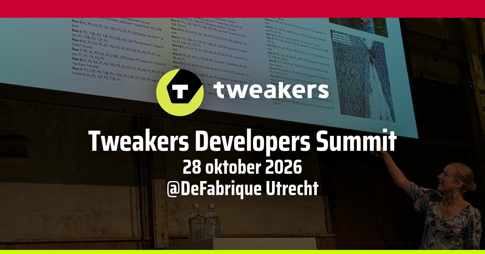
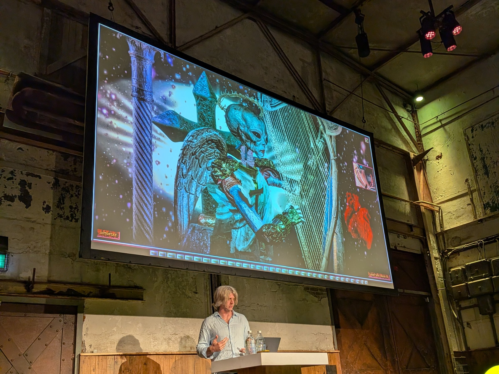
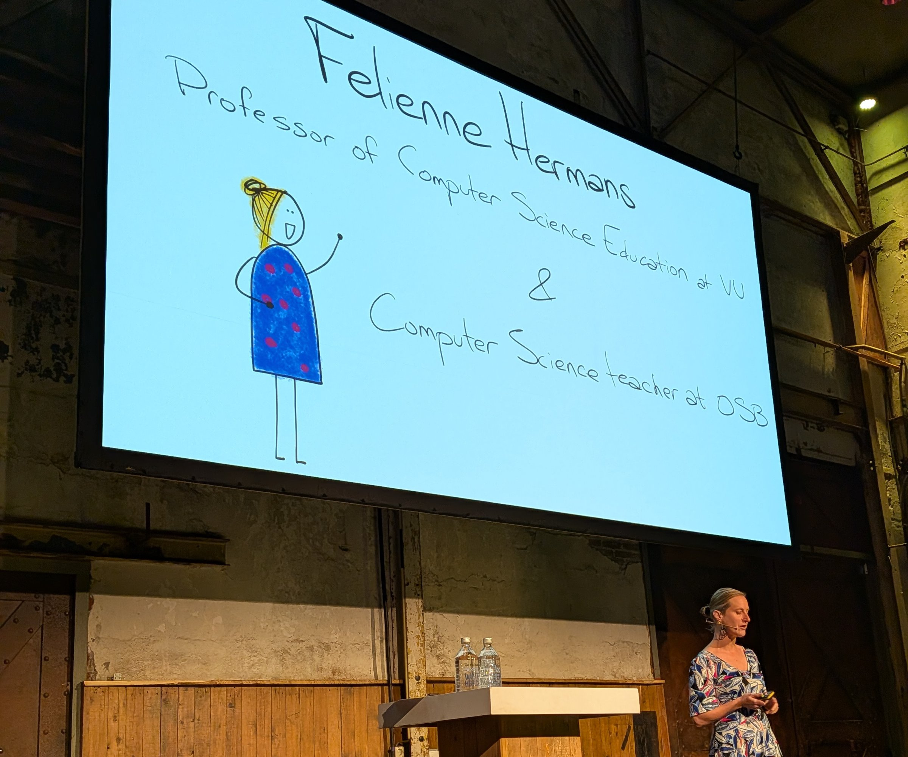
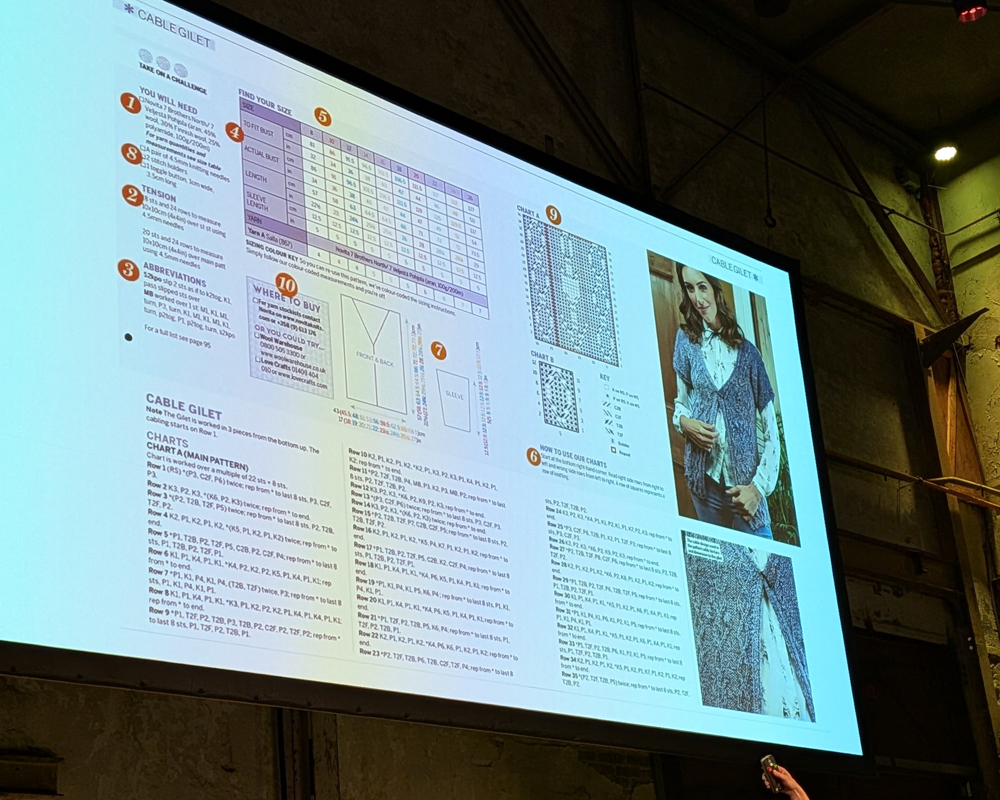
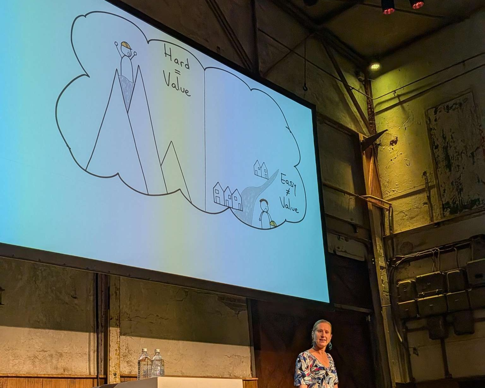
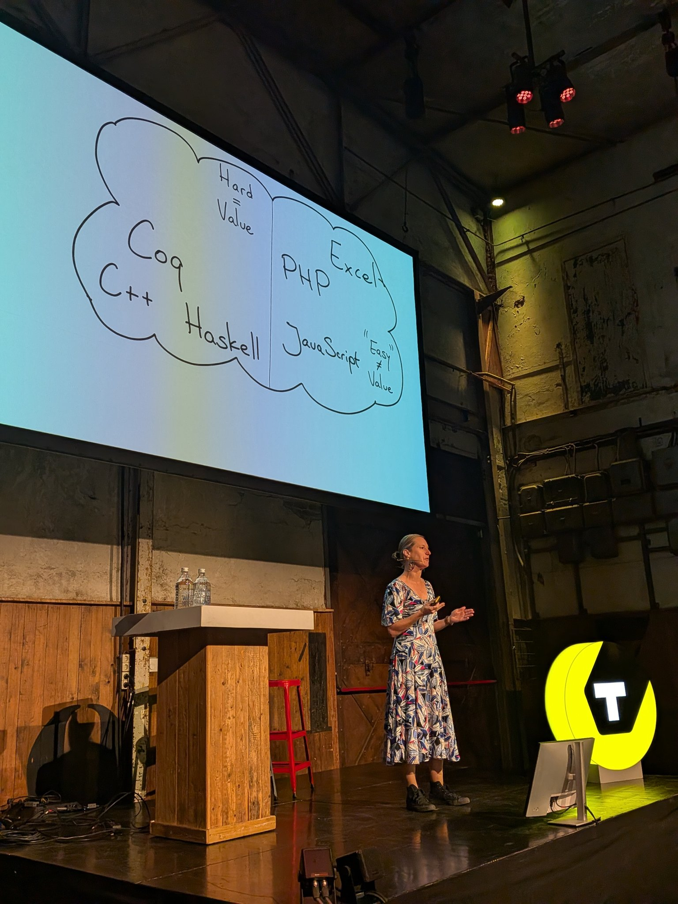
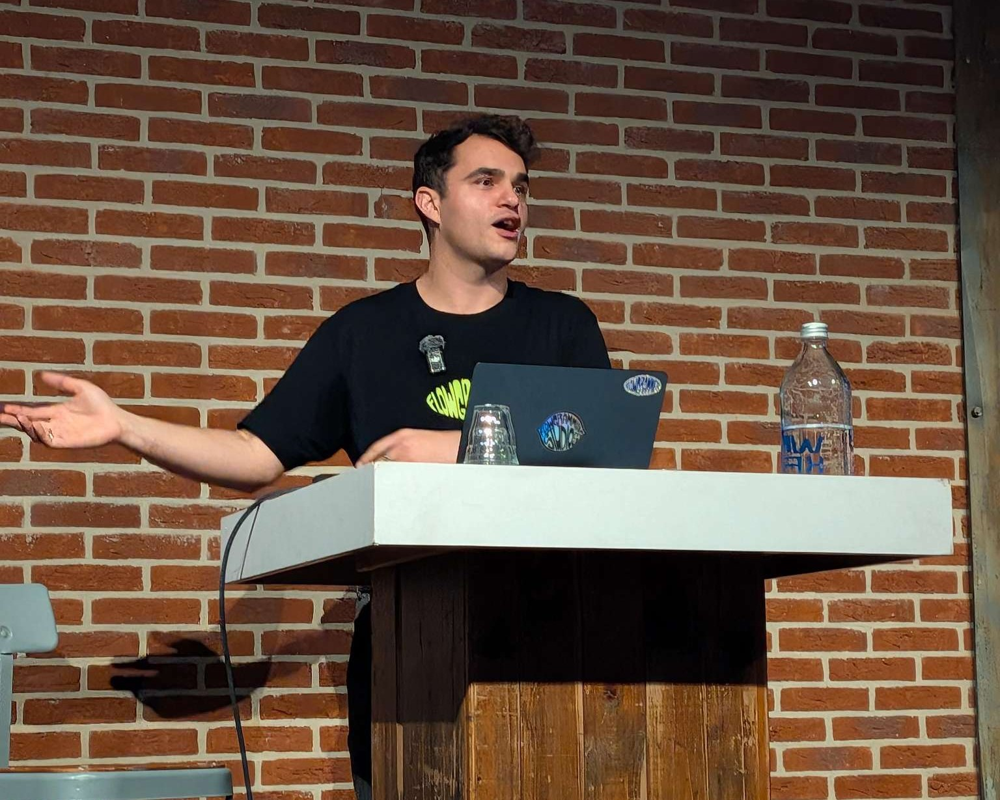
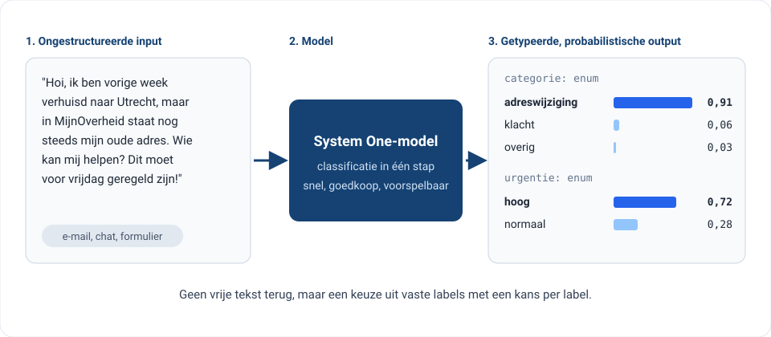
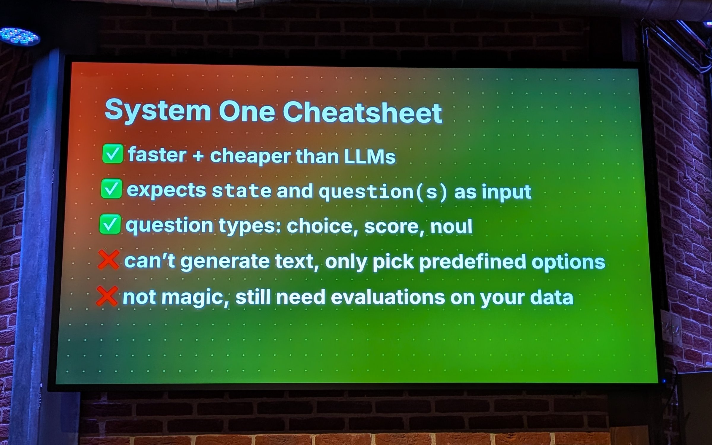
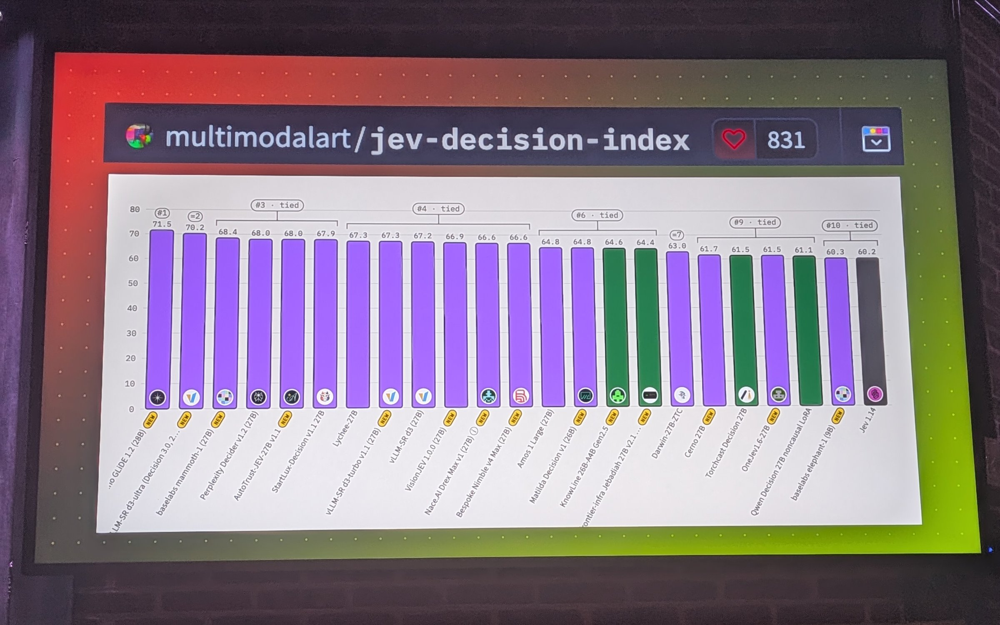

# Tweakers Developers Summit 2026: van feminisme tot System One AI modellen



Op woensdag 28 oktober was ik op de Tweakers Developers Summit in Utrecht. Het was voor mij de eerste keer dat ik aansloot bij dit relatief grote dev event, waar er weer veel te veel interessante talks waren om allemaal bij te kunnen wonen. Tweakers heeft natuurlijk het imago van een DIY-forum en dit was terug te zien in het aanbod; dat varieerde van uit de hand gelopen hobbyprojecten tot een deepdive in de evolutie van Java.

<!-- truncate -->

Wat zeer ten positieve bijdroeg aan de hackerfeeling van de conferentie was de locatie: De Fabrique in Utrecht. De plek heeft een mooie industriële vibe en af en toe voelt het alsof je rondloopt in een level van **Unreal Tournament (1999) GOTY**, voor de mensen die dat nog kennen ;).

Ook de opkomst was goed: bij de plenaire sessies zat de grote zaal behoorlijk vol. Elk jaar komen er zo'n 500 tot 600 tweakers en developers op de summit af.

## Openingstalk: Geoffrey Lillemon (CGI art)

De dag opende met een behoorlijk psychedelische talk, namelijk die van Geoffrey Lillemon (Amsterdam-based digital artist). In razend tempo liep de kunstenaar door allerlei bizarre digitale scapes heen waarbij de data die in elke scene gegenereerd werd, weer input was voor de volgende scene. Er kwamen trollen en demonen voorbij, die dan ook nog eens autonoom viool bleken te spelen. Al met al een duizelingwekkende ervaring, maar erg tof om te zien (ook op technisch vlak).



## Keynote: Felienne Hermans (feminisme in de software-industrie)

Daarna vervolgden we plenair met een zeer verfrissende talk van Felienne Hermans over inclusiviteit in de IT, of eigenlijk vooral het gebrek daaraan. Aan de hand van haar eigen verhaal en voorbeelden illustreerde ze heel sterk hoe onze industrie is geënt op stereotypen. 



Zo vertelde ze over haar sollicitatie als hoogleraar waar de eerste vraag was: "Ben jij eigenlijk wel technisch genoeg?". Een hoogst opmerkelijke vraag voor iemand die talloze compiler-vakken volgde, zelf compilers schreef en een eigen programmeertaal ([Hedy](https://hedy.org/)) bouwde.

### Breien
Daarnaast geeft ze het voorbeeld van breien. Breien wordt niet gezien als een technische bezigheid terwijl het in feite een door en door wiskundige activiteit is. Patronen (de naam zegt het al) vereisen pittige berekeningen als je een trui in een andere maat dan die in je originele instructies wilt breien. Hermans breide in haar jeugd al graag, maar hoorde nooit: "Goh wat kan ze dat goed, die gaat vast naar de TU later!".



### Complex == goed

Nog een interessant inzicht wat ik herkenbaar vond was de neiging om complexe dingen als iets goeds te zien. Talen die "dicht op het metaal" zitten worden meer gewaardeerd, terwijl het niet per se efficiënte talen zijn om mee te werken. 

### Het voorbeeld: gletsjeronderzoek & feminisme
Het voorbeeld wat ze daar aan vastknoopt is het voorbeeld van een onderzoek waarin gletsjeronderzoek door een feministische bril wordt bekeken. Belangrijk om te weten is dat je grofweg twee soorten gletsjers kan onderscheiden: gletsjers die zich hoog in de bergen bevinden en slecht bereikbaar zijn, en gletsjers die zich in dalen bevinden die zich bij wijze van spreken gewoon naast bebouwing bevinden.


*Over het voorbeeld van gletsjers*

Dan zou je denken dat er meer data beschikbaar is over de dal-gletsjers die veel toegankelijker zijn dan de gletsjers tussen de pieken van bergen. Echter, het tegenovergestelde blijkt waar! Er is nauwelijks data over de dal-gletsjers. De conclusie is dat het gewoonweg voor mannelijke onderzoekers niet interessant is om toegankelijke gletsjers te monitoren en te onderzoeken: dat is simpelweg geen heldhaftige uitdaging. Aldus: "Hard" > "Easy", wat het verder voor de wetenschap ook betekent. 

Wat mij betreft een interessant inzicht: het verklaart voor mij de populariteit en aanzien van programmeertalen als Rust en Go. Dit zijn in de praktijk talen met een pittige learning-curve die echt niet voor elke app logisch of handig zijn. Toch staan ze bekend als "coole" talen. Dit illustreert Hermans nog met de volgende slide waarin ze duidt dat taaie programmeertalen automatisch hoger in aanzien staan:



Dit is een neiging die je niet zonder consequenties kunt zien. Als wij engineers een voorliefde hebben voor technisch complexe oplossingen dan hebben we waarschijnlijk een tech-landschap dat ook nodeloos complex is, en waaruit weer allerlei lastig onderhoudswerk komt. Looking at you mensen die overal een SPA (Single-Page-Application) voor gebruiken ;).

## Max Tkacz: LLM's vs System One Models (type-safe/ decision AI)

In deze talk leerde ik iets waar ik nog niet eerder bij stil had gestaan. Wellicht wat naïef maar bij AI dacht ik vooral nog aan GenAI, in deze talk leerde ik over System One modellen die handig zijn bij het classificeren van teksten/ input. Het meest bekende System One model dat op de markt is [Jev](https://typesafe.ai/blog/introducing-system-one-models-and-jev).

Max Tkacz is trouwens ook tech-influencer en beter bekend als de "Flowgrammer". Daar ik nog nooit een presentatie had bijgewoond van een heuse tech-influencer was ik erg benieuwd. Mijn verwachting kwam uit; hij bleek een goede verteller.



### System One Models
Voordat ik m'n verhaal vervolg is het belangrijk om te weten wat "System One Models" precies zijn. Wat het doet is conceptueel iets heel simpels, en in potentie heel bruikbaars: het neemt namelijk ongestructureerde input (zoals een stukje tekst) en maakt er getypeerde, probabilistische uitkomsten van.



Tkacz geeft in z'n talk een aantal voorbeelden van input questions die je aan een System One model kan voeden:

- een `choice`, voor een categorische keuze.
- een `score`, voor iets wat zich op een schaal beweegt.
- en een `noul` (boolean), die alleen "yes" of "no" teruggeeft, met probability.

### Voorbeeld: supportticket

Stel dat er dit supportticket binnenkomt:

> "Hi, I was charged twice for order #4821. Can you please fix this?"

Hieronder per type de query, en daaronder een voorbeeld van wat er terugkomt.

#### Type: `choice`
```json
{
    "type": "choice",
    "instructions": "Which team should handle this ticket?",
    "criteria": ["billing", "shipping", "returns"]
}
```

```json title="response"
{
    "choice": "billing",
    "probabilities": {
        "billing": 0.93,
        "returns": 0.05,
        "shipping": 0.02
    }
}
```

#### Type: `score`
```json
{
    "type": "score",
    "instructions": "How complex is this request?",
    "criteria": ["trivial", "moderate", "complex"]
}
```
```json title="response"
{
    "score": "moderate",
    "probabilities": {
        "trivial": 0.24,
        "moderate": 0.66,
        "complex": 0.10
    }
}
```

#### Type: `noul`
```json 
{
    "type": "noul",
    "instructions": "Is the customer asking for a refund?"
}
```

```json title="response"
{
    "answer": "yes",
    "probability": 0.81
}
```

Je krijgt dus nooit een lap tekst terug, maar altijd een van de labels die je zelf hebt opgegeven, met een `probability` erbij. Daar kun je in code direct op sturen: is de kans lager dan bijvoorbeeld 0,8, dan gaat het ticket naar een mens.

### Bottom line

Tkacz vatte het geheel samen in een praktische cheatsheet. System One-modellen zijn sneller en goedkoper dan LLM's omdat ze niet iteratief tekst hoeven te genereren: ze kiezen alleen uit opties die je vooraf zelf hebt gedefinieerd.

De output valt dus altijd binnen een vaste set labels. Zo kun je veel makkelijker met de output programmeren dan bij een LLM. Tegelijk waarschuwt Tkacz terecht dat het geen magie is: je moet nog steeds evaluaties draaien op je eigen data om te weten of het model in jouw context de juiste keuzes maakt.

Binnen de overheid zijn er genoeg toepassingen te bedenken. Denk aan het doorsturen van vragen van burgers naar het juiste loket (Signalen app anyone?), of het voorsorteren van meldingen. En omdat de uitkomst voorspelbaar en toetsbaar is, past dit beter bij de overheid dan een LLM die vrije tekst genereert. Daar eisen we immers uitlegbaarheid en traceerbaarheid.



### Open alternatieve modellen beschikbaar

Gelukkig zijn er naast Jev ondertussen veel Open Weights modellen beschikbaar die je kunt gebruiken als decision model. De open modellen zijn ondertussen ook nog [behoorlijk performant](https://huggingface.co/spaces/multimodalart/jev-decision-index). Dat maakt de adoptie in soevereine setting gelukkig ook mogelijk.



## Later meer over mijn eigen presentatie

Ik was niet alleen als bezoeker op de summit: ik gaf er zelf ook een praatje over developer.overheid.nl. Daarover nog niks in deze post: wat ik precies heb verteld, bewaar ik voor een uitgebreidere blogpost die volgende week verschijnt.