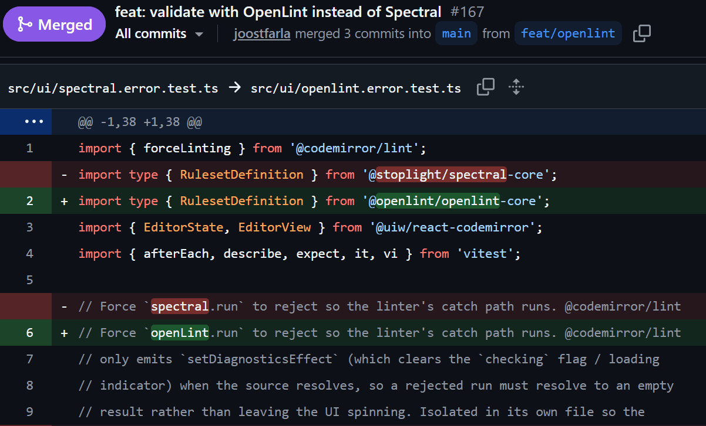
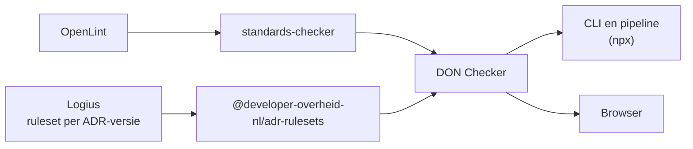

# Het is zover: OpenLint vervangt Spectral



Vanaf deze week draait alle tooling van developer.overheid.nl op
[OpenLint](https://openlint.org/), de opvolger van Spectral. We zijn daar sinds
juli actief bij betrokken, zowel bij de specificatie van het rulesetformaat als
in de discussies over de koers van het project. Toen onlangs versie 1.0
verscheen, hebben we onze tooling, inclusief de DON Checker, direct omgezet. De
rulesets die we hebben geschreven voor de
[API Design Rules (ADR)](/kennisbank/api-ontwikkeling/standaarden/api-design-rules)
en voor de validatie van
[OAS](/kennisbank/api-ontwikkeling/standaarden/openapi-specification),
[publiccode.yml](/kennisbank/open-source/standaarden/publiccode-yml) en JSON-FG
werken daarbij zonder aanpassingen.

<!-- truncate -->

:::success[TL;DR]

- OpenLint is de definitieve naam van de opvolger van Spectral, die in juli nog
  als fork onder API Commons werd getest. Het project wordt gebouwd door een
  community waar developer.overheid.nl actief aan meedoet, en wij hebben het
  rulesetformaat vastgelegd in een eigen specificatie zonder het formaat zelf te
  veranderen. Versie 1.0 staat inmiddels op npm.
- Het project krijgt een vaste plek bij
  [Open Source Europe](https://opensourceeurope.com). De Nederlandse overheid is
  via developer.overheid.nl aan boord, en er is ook interesse vanuit onder meer
  Italië en Duitsland.
- Bestaande rulesets, waaronder die van de ADR, werken zonder aanpassingen.
- Gebruik je Spectral rechtstreeks, vervang de package dan door OpenLint of
  gebruik nog liever de
  [DON Checker](https://github.com/developer-overheid-nl/don-checker).

:::

Deze blogpost is een vervolg op
[Spectral onder vuur: waar wij staan](/blog/2026/07/31/spectral-onder-vuur) uit
juli. Daarin gingen we in op het supply chain-incident van 14 juli, toen er twee
kwaadaardige versies van `@asyncapi/specs`, een dependency van Spectral, op npm
verschenen. Wie in dat tijdvenster een verse install deed, haalde code binnen
die onder meer SSH-keys, tokens en credentials weg kon sluizen. Het incident
zelf was snel opgelost, maar het bleef stil op het issue daarover op de
Spectral-repository. Voor veel gebruikers was dat de druppel, omdat er al
honderden issues openstonden en bugs in de VS Code-plugin al lange tijd niet
werden opgepakt.

We hebben er toen bewust voor gekozen om Spectral er niet halsoverkop uit te
slopen. We hielden Spectral op een zelf vastgestelde versie en stapten niet over
op [vacuum](https://quobix.com/vacuum/), omdat dat het rulesetformaat niet
volledig ondersteunt, in de praktijk door één persoon wordt onderhouden en in Go
is geschreven, terwijl onze tooling ook in de browser moet draaien. In plaats
daarvan bouwden we mee aan de fork die [Kin Lane](https://apievangelist.com),
beter bekend als The API Evangelist, onder API Commons was gestart. Voor
iedereen die de hele zomervakantie wakker lag van "Spectralgate" en zich afvroeg
wat logische vervolgstappen waren, is OpenLint nu het antwoord.

## Wat is OpenLint?

OpenLint is een open specificatie en toolbox voor het linten van
API-beschrijvingen, die in het openbaar door een community wordt beheerd. Het
begon met de fork van Spectral die Kin Lane onder API Commons testte. Anderen
uit de community hebben daar een clone van gemaakt en die grondig opgeschoond,
door eruit te halen wat specifiek aan Spectral hing, openstaande issues en pull
requests op te pakken en de dependencies bij te werken. Daarbij is ook de
"telemetrie" van Spectral eruit gesloopt.

Naast die opschoning is er ook gewerkt aan de specificatie, en daar zit een
belangrijk deel van de bijdrage van developer.overheid.nl. Bij Spectral was het
rulesetformaat niet meer dan wat de linter in de praktijk accepteerde. Wij
hebben het formaat vanuit de bestaande Spectral-code helemaal herschreven tot
een eigen [specificatie](https://openlint.org/spec), die met ReSpec is
gepubliceerd, een JSON Schema bevat en de eisen vastlegt in termen van MUST en
SHOULD. Daarmee zijn de specificatie en de toolbox van elkaar losgemaakt, zodat
elke linter het formaat kan implementeren en OpenLint daar één van is.

De ambitie reikt ook verder dan die van Spectral. OpenLint moet uiteindelijk
meer standaarden en formaten kunnen linten dan alleen OpenAPI, AsyncAPI en
Arazzo, en wij willen er onder meer Nederlandse overheidsstandaarden zoals
NL-SBB en [DCAT-AP-NL](https://docs.geostandaarden.nl/dcat/dcat-ap-nl30/) aan
toevoegen. Daarbij is OpenLint niet afhankelijk van één persoon of een
commerciële vendor. Er werken onder meer mensen aan mee uit de communities rond
OpenAPI, AsyncAPI en Arazzo, mensen die eerder aan Spectral zelf hebben
meegewerkt en collega's van andere overheden.

In juli zeiden we ook dat we zouden helpen zoeken naar een plek om te landen,
want een fork is nog geen standaard. Die plek hebben we gevonden bij
[Open Source Europe](https://opensourceeurope.com), waar OpenLint onder gaat
vallen. Daarmee komt het formaat waarin de ADR-ruleset is beschreven in Europese
publieke handen terecht.

We streven ernaar om OpenLint op 3 december officieel te lanceren tijdens de
[Europe API](https://europeapi.com)-track van apidays Paris. Daar hoef je niet
op te wachten, want versie 1.0 is er al en je kunt er nu mee aan de slag.

## Aan de slag

Gebruik je Spectral, stap dan direct over op OpenLint. Je hoeft je rulesets niet
om te zetten, en de CLI pikt je bestaande `.spectral.yaml` nog steeds op, al kun
je in nieuwe projecten ook `.openlint.yaml` gebruiken. Voor de CLI vervang je de
package en het commando zoals hieronder.

```diff
- npm install --save-dev @stoplight/spectral-cli
+ npm install --save-dev openlint

- npx spectral lint openapi.yaml
+ npx openlint lint openapi.yaml
```

Roep je de linter aan vanuit je eigen code, dan veranderen de import en de naam
van de klasse, terwijl de `RulesetDefinition` en je ruleset zelf gelijk blijven.

```diff
- import { Spectral, type RulesetDefinition } from "@stoplight/spectral-core";
+ import { OpenLint, type RulesetDefinition } from "@openlint/openlint-core";
```

Nog beter is het om de
[DON Checker](https://github.com/developer-overheid-nl/don-checker) te
gebruiken. Dat is het overkoepelende stuk software waar zowel de
[ADR Checker](/kennisbank/api-ontwikkeling/tools/api-design-rules-linter) als de
[publiccode.yml checker](/kennisbank/open-source/tools/publiccode-yml-checker)
onder vallen, en in juli adviseerden we al om de ADR Checker te gebruiken in
plaats van Spectral rechtstreeks. Dan ben je niet direct afhankelijk van een
linter, omdat wij de linter en de rulesets voor je bijhouden. Dat geeft ons
bovendien de ruimte om meer functionaliteit te bieden dan alleen linten.

De DON Checker is een implementatie van de
[standards-checker](https://github.com/Geonovum/standards-checker), die
inmiddels dus op OpenLint draait. De ADR-rulesets zitten in een eigen package,
die wordt gegenereerd uit de ruleset die Logius bij elke versie van de
[ADR](https://gitdocumentatie.logius.nl/publicatie/api/adr/) publiceert. De
ruleset voor publiccode.yml zit in de DON Checker zelf.



De DON Checker draait met één `npx`-commando, en daarmee ook in elke pipeline
waar Node.js beschikbaar is.

```sh
npx @developer-overheid-nl/don-checker@latest \
  validate --standard adr --input ./openapi.json
```

Met `--standard publiccode` controleer je op dezelfde manier een publiccode.yml.

Kant-en-klare voorbeelden voor GitLab CI en GitHub Actions vind je op de pagina
over de
[ADR Checker](/kennisbank/api-ontwikkeling/tools/api-design-rules-linter) in
onze kennisbank.

## De volgende stappen voor OpenLint

Met OpenLint 1.0 zijn we er nog niet, en de komende tijd houden we ons onder
meer met de volgende onderwerpen bezig.

De VS Code-plugin werkt al geruime tijd niet goed. Een structurele oplossing
daarvoor is LSP-functionaliteit voor OpenLint, waarmee je de linter in elke IDE
kunt gebruiken zonder voor elke editor een aparte plugin te hoeven onderhouden.
Daar gaan we aan meehelpen.

Daarnaast brengen we de verschillen met vacuum in kaart. Er is niets mis met
vacuum, en volgens de eigen omschrijving is het volledig compatibel met
Spectral-rulesets, maar in de praktijk zijn er toch verschillen. Die komen
grotendeels voort uit Spectral-legacy, omdat het rulesetformaat nauw verweven is
met JavaScript, bijvoorbeeld in hoe reguliere expressies en JSONPath werken.
Daar heeft vacuum eigen implementaties voor, en op sommige punten volgt vacuum
de onderliggende standaarden zelfs beter dan Spectral. Wij bouwen bewust voort
op het rulesetformaat van Spectral, omdat dat wereldwijd veel gebruikt wordt,
maar willen de specificatie wel los houden van de software. We laten liever de
tooling de standaarden volgen dan dat we JavaScript-specifieke zaken in de
specificatie vastleggen. Idealiter wordt vacuum straks gewoon een
Go-implementatie van die specificatie, zodat een ruleset overal hetzelfde
resultaat geeft, ongeacht welke linter je gebruikt.

Wat we daarbij leren, nemen we mee in een nieuwe versie van de specificatie. Die
moet backwards compatible blijven met bestaande rulesets, maar zo zijn opgesteld
dat een ruleset zowel in de OpenLint-toolbox als in vacuum op dezelfde manier
werkt. In die versie willen we ook ruimte maken voor andere formaten dan
OpenAPI, AsyncAPI en Arazzo, zodat bijvoorbeeld de Nederlandse
overheidsstandaarden die we eerder noemden ermee gelint kunnen worden.

Ook willen we bijdragen aan het educatieve deel, zodat het makkelijker wordt om
goede rulesets te schrijven. Denk daarbij aan tutorials en aan herbruikbare
aliases voor veelvoorkomende regels, zoals `given`-paden die in veel rulesets
terugkomen of reguliere expressies die je anders steeds opnieuw schrijft.

Tot slot brengen we onze eigen praktijk in. Omdat Spectral in de ADR zelf is
opgenomen, hebben we veel use cases en is backwards compatibility voor ons
belangrijk. Bij elke doorontwikkeling van de specificatie en de toolbox testen
we daarom of bestaande rulesets, waaronder die van de ADR, blijven werken.

## Meedoen

De komende tijd gaan we flink aan de slag met OpenLint, zowel met de
specificatie en de onderwerpen hierboven als in de discussies over de koers van
het project, en we hopen dat je meedoet. Probeer OpenLint uit en laat ons weten
wat je tegenkomt. Ideeën, testresultaten en vragen kun je bij ons kwijt via
[developer.overheid@geonovum.nl](mailto:developer.overheid@geonovum.nl) of in
[#developer-overheid.nl](https://codefornl.slack.com/archives/CFV4B3XE2) op de
Slack van Code for NL. Je kunt ook op GitHub direct bijdragen aan de
[linter](https://github.com/openlint/openlint) of de specificatie, of
aanschuiven bij de Office Hours die via de
[community-repository](https://github.com/openlint/community) worden
aangekondigd. Hoe meer partijen meedoen, hoe sterker de basis wordt waar we
allemaal op bouwen.

Mis je iets in de DON Checker of loop je ergens tegenaan, meld het dan in de
[issues van de DON Checker](https://github.com/developer-overheid-nl/don-checker/issues).
Gaat het om de API Design Rules zelf, meld het dan bij Logius als beheerder van
de ADR, in de
[issues van de API Design Rules](https://github.com/Logius-standaarden/API-Design-Rules/issues).
