import { Blockquote } from "@rijkshuisstijl-community/components-react";

# NL Wallet onder de motorkap: in gesprek met het team

Het ministerie van Binnenlandse Zaken en Koninkrijksrelaties bouwt een digitale
identiteitswallet, werknaam: NL Wallet. Daarmee kun je in de toekomst inloggen
bij overheidsorganisaties en bedrijven, gegevens delen zoals je diploma of
rijbewijs en documenten elektronisch ondertekenen. Allemaal vanuit één app. Een
interessant traject dat voortkomt uit een Europees kader (eIDAS) en volledig
open source wordt ontwikkeld.

<!-- truncate -->

We spraken met **Tim Speelman** (beleidsmedewerker en product owner), **Sietse
Ringers** (architect en developer) en **Jacob Middag** (developer) over de
technische keuzes, hoe privacy by design werkt in de praktijk en hoe developers
kunnen aanhaken.

:::success[TL;DR]

- De overheid implementeert de Europese eIDAS-verordening: elke lidstaat moet
  ervoor zorgen dat burgers die dat willen een digitale identiteitswallet kunnen
  gebruiken. Hiertoe ontwikkelt de overheid de NL Wallet, en een stelsel waarop
  ook private EDI-wallets kunnen aansluiten.
- Gegevens worden lokaal opgeslagen op het apparaat van de gebruiker. Een
  ontvanger vraagt alleen de gegevens die nodig zijn, en de gebruiker beslist of
  hij die deelt.
- Het stelsel is open: elke in de EU gevestigde organisatie kan aansluiten en
  kaartjes uitgeven of ontvangen door Europese standaarden te volgen.
- Het uitgangspunt is privacy by design: de app verstuurt alleen de hoogst
  noodzakelijke gegevens en vermijdt unieke identifiers voor zover mogelijk.
- De [broncode](https://github.com/MinBZK/nl-wallet/) is open source.

:::

## Introductie

### Tim Speelman, product owner

Tim studeerde in Delft, eerst Industrieel Ontwerpen (bachelor) en daarna
Computer Science (master). In die master specialiseerde hij zich in digitale
identiteit. Zijn masterscriptie bracht hem in contact met RvIG, ICTU en de Kamer
van Koophandel. Sinds september 2021 werkt hij als beleidsmedewerker bij het
ministerie van Binnenlandse Zaken en Koninkrijksrelaties[^ezk]. In deze context
is hij product owner van het NL Wallet-team, een traject dat in augustus 2022
startte.

[^ezk]:
    De beleidsverantwoordelijkheid voor het dossier ligt sinds de start van dit
    kabinet bij het ministerie van Economische Zaken (EZK).

### Sietse Ringers, architect en developer

Sietse promoveerde in 2016 op cryptografie en identity management. Daarna werkte
hij als architect en developer aan IRMA, inmiddels bekend als Yivi. Op dit
moment is hij als architect en developer betrokken bij de NL Wallet. Als
architect is hij verantwoordelijk voor de securitykeuzes die gemaakt worden in
het project.

### Jacob Middag, software engineer

Jacob werkte in 2015–2016 bij DigiD als Rails-developer, waar hij onder andere
aan de backend voor de DigiD-app werkte. Na een opdracht bij ICTU volgden andere
projecten, totdat een oud-collega hem wees op een opdracht bij het NL
Wallet-team. Zijn achtergrond met DigiD komt direct van pas in zijn huidige rol,
met focus op de Rust-backend en DevOps voor testomgevingen.

_Van links naar rechts: Jacob Middag, Sietse Ringers en Tim Speelman_

## Eén Europese digitale wallet

**Wat is de NL Wallet en waarom is het handig?**

**Tim**: De NL Wallet is een Europese digitale identiteitswallet. Het Europese
kader (de eIDAS-verordening) schrijft voor dat elke lidstaat ervoor moet zorgen
dat burgers die dat willen een wallet kunnen gebruiken. Daarmee kun je inloggen
bij overheidsdiensten en bedrijven die zijn aangesloten, gegevens delen zoals
diploma's en straks je rijbewijs, en elektronisch ondertekenen. Dat allemaal
vanuit één app, op een gestandaardiseerde manier die met veel toepassingen
werkt.

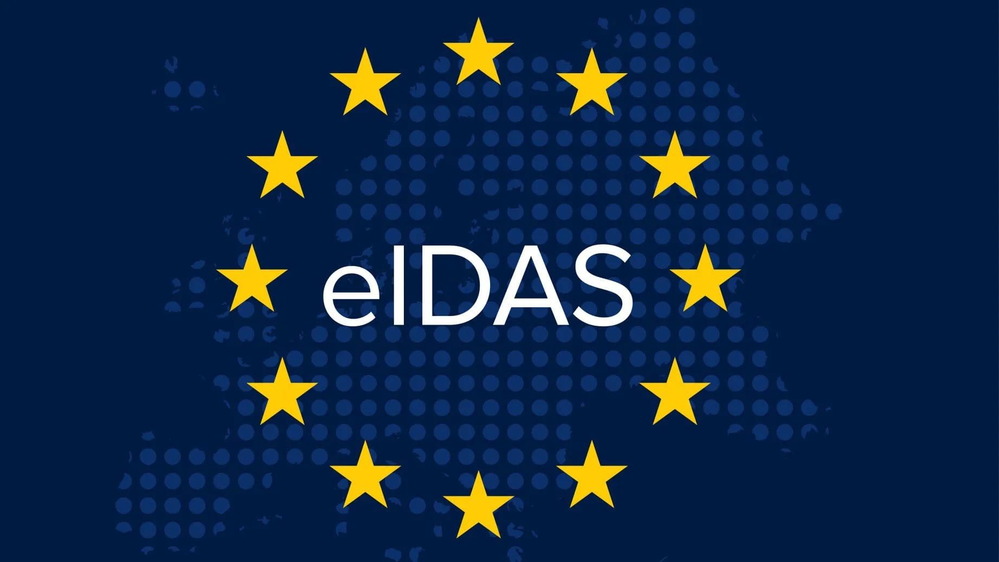

### Geen rondslingerende PDF's meer

Het belangrijkste voordeel is dat je als gebruiker de regie over je eigen
gegevens voert. Het wordt ook eenvoudiger om informatie aan te leveren in
bepaalde processen: je hoeft niet meer te werken met papier, pdf's of andere
onveilige methoden.

**Sietse**: Voor de burger is het uiteindelijk een app waar hij zijn
identiteitsgegevens in verzamelt. Die worden lokaal opgeslagen op de telefoon
zelf, niet op een server ergens. Daarna kun je ze vrijgeven aan derde partijen,
online of fysiek in persoon. Je deelt alleen de gegevens die nodig zijn, niet
meer, en dat gebeurt op een veilige en privacyvriendelijke manier. Voordat je
iets deelt, laat de wallet zien om welke gegevens het gaat en vraagt om je
toestemming.

**Jacob**: En voor die derde partij is het fijn dat ze een veel betrouwbaardere
ondertekening hebben. In plaats van een ingescand energiecontract om je adres te
bewijzen, krijg je cryptografisch gegarandeerde, betrouwbare gegevens.

<Blockquote
  attribution="- Jacob Middag, developer"
  variation="pink-background"
>
"Voor die derde partij is het fijn dat ze een veel betrouwbaardere ondertekening
hebben. In plaats van een ingescand energiecontract om je adres te bewijzen,
krijg je cryptografisch gegarandeerde, betrouwbare gegevens."
</Blockquote>

## Decentrale opzet

De wallet-architectuur heeft een decentrale opzet en werkt daarom fundamenteel
anders dan bijvoorbeeld DigiD.

### Gegevens op je eigen telefoon

**DigiD** werkt centraal: tijdens het inloggen verstuurt DigiD jouw BSN naar de
dienstverlener, zodat die weet wie er inlogt.

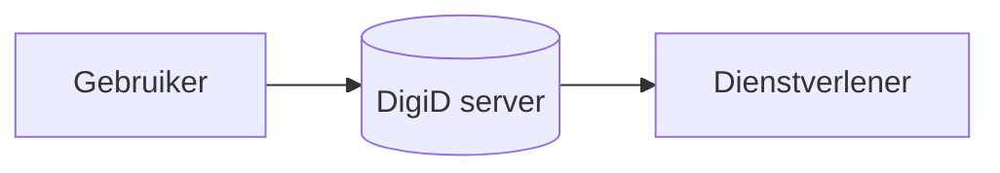

**NL Wallet** werkt decentraal: jouw gegevens staan op jouw telefoon. De
dienstverlener communiceert rechtstreeks met de wallet-app. Vooral voor private
dienstverleners is dat iets nieuws: zij kunnen nu meestal niet bij
basisregistraties en krijgen gegevens alleen van de gebruiker zelf. De wallet
stelt de gebruiker in staat om dit op een veilige manier te doen.

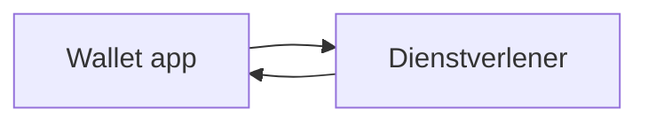

## De metafoor van de portemonnee

De metafoor wallet duidt op de fysieke portemonnee: een herkenbaar concept voor
de gebruiker. In je fysieke portemonnee bewaar je ook bijvoorbeeld:

- Je rijbewijs
- Pasjes van verschillende lidmaatschappen
- Je zorgverzekeringspas

De wallet doet in principe hetzelfde, maar dan digitaal: het is een digitale
plek voor je persoonsgegevens en je gebruikt deze om te laten zien wie je bent,
of dat je gemachtigd bent om iets te doen. Niet al deze kaartjes komen straks
direct in de wallet; sommige komen op termijn beschikbaar. Uiterlijk 2029 wordt
het bijvoorbeeld mogelijk om je rijbewijs aan de wallet toe te voegen.

Dit is ook de reden dat er binnen dit project zoveel aandacht wordt besteed aan
security en privacy; het is een app met daarin gevoelige data.

## Hoe werkt het?

Het gebruik van de app vindt plaats volgens de volgende stappen:

### 1. Wallet activeren (personaliseren)

Na het downloaden van de app moet de wallet eenmalig worden geactiveerd. Eerst
stelt de gebruiker een zes-cijferige code in, daarna identificeert de gebruiker
zich op het hoogste betrouwbaarheidsniveau met DigiD. Daarna worden
persoonsidentificatiegegevens (PID) uit de Basisregistratie Personen (BRP),
zoals naam en geboortedatum, aan de wallet toegevoegd. Deze gegevens zijn nodig
om de wallet te gebruiken.

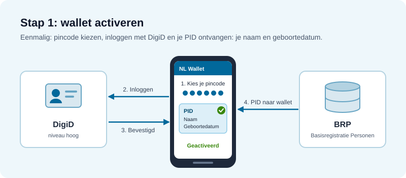
_Vereenvoudigde schematische weergave door Claude Opus 5.5_

### 2. Kaartjes ophalen (issuing)

De gebruiker vraagt een kaartje (attestatie) met bijvoorbeeld persoonsgegevens
op bij een uitgever. Dit kan bijvoorbeeld zijn:

- Een diploma dat je hebt behaald bij een onderwijsinstelling.
- Je rijbewijs bij de RDW.

De uitgever van het kaartje valideert de identiteit en stuurt een cryptografisch
ondertekende attestatie naar de wallet. Die wordt lokaal op de telefoon
opgeslagen.

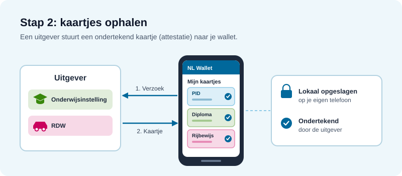
_Vereenvoudigde schematische weergave door Claude Opus 5.5_

### 3. Presenteren (verifying)

Een ontvanger stuurt een verzoek: "bewijs dat je in het bezit bent van een
geldig rijbewijs." De wallet toont dit verzoek aan de gebruiker, die beslist om
te delen of niet. Alleen de gevraagde attributen gaan de deur uit.

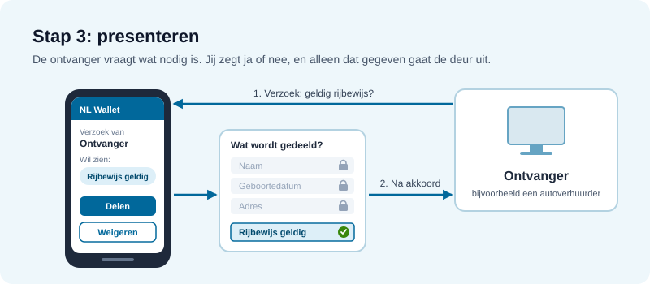
_Vereenvoudigde schematische weergave door Claude Opus 5.5_

### 4. Verificatie van het kaartje

De ontvanger controleert de handtekening van de uitgever op de attestatie en
valideert de gedeelde attributen. Helemaal zonder server gaat dat niet. Bij het
presenteren (stap 3) ondertekent de wallet-backend, die de sleutels namens de
gebruiker beheert, een bewijs dat de wallet het kaartje echt bezit (**proof of
possession**). Zo ziet de dienstverlener dat het om de legitieme gebruiker gaat
en niet om een gekopieerd kaartje. De backend krijgt daarbij alleen een hash te
zien: hij ziet dat de gebruiker actief is, ook ziet hij welke sleutel de
gebruiker gebruikt. Maar niet welke gegevens hij precies deelt, en ook niet met
welke dienstverlener hij zaken doet.

#### Privacyvriendelijk verifiëren met `Token Status Lists`

Daarnaast kan de ontvanger, afhankelijk van de toepassing, nagaan of een kaartje
nog geldig is. Dat gebeurt op een privacyvriendelijke manier via Token Status
Lists. De uitgever publiceert een lange lijst met de status van heel veel
uitgegeven kaartjes. De ontvanger haalt die hele lijst op en zoekt daarin zelf
het kaartje op, zodat de uitgever niet weet naar welk kaartje de ontvanger op
zoek is.

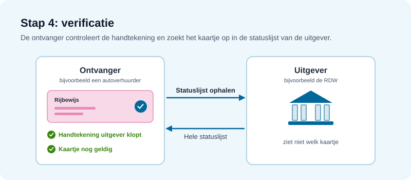
_Vereenvoudigde schematische weergave door Claude Opus 5.5_

## De workflow

Achter deze vier stappen zitten drie losse flows. De activatie doe je één keer,
als je de app installeert. Daarna gebruik je de wallet zo vaak als je wilt,
zonder opnieuw met DigiD in te loggen of je PID op te halen.

### **Eenmalig: wallet activeren**

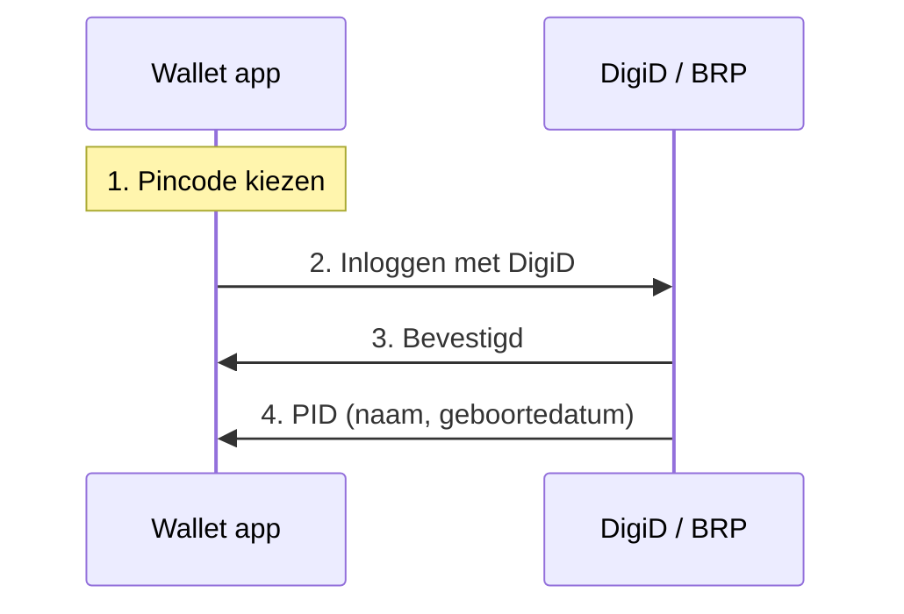

_Vereenvoudigde weergave. De volledige flow staat in de NL Wallet-documentatie
over
[het aanmaken van de wallet](https://github.com/MinBZK/nl-wallet/blob/main/wallet_docs/architecture/use-cases/wallet-creation.md)
en
[het ophalen van de PID](https://github.com/MinBZK/nl-wallet/blob/main/wallet_docs/architecture/use-cases/issuance-with-openid4vci.md#pid-issuance)._

 

### **Kaartje ophalen: eenmalig per kaartje (issuing)**

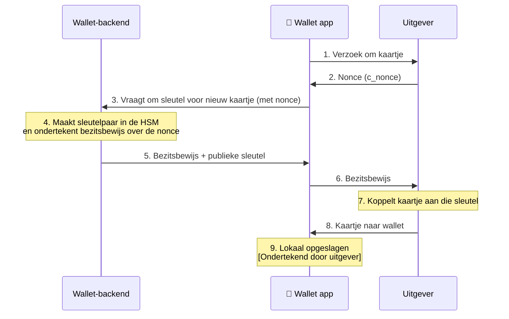

_Vereenvoudigde weergave. De volledige flow staat in de
[NL Wallet-documentatie over issuance](https://github.com/MinBZK/nl-wallet/blob/main/wallet_docs/architecture/use-cases/issuance-with-openid4vci.md)._

:::info[Wat is een nonce?]

Een **willekeurige code die maar één keer geldig is** (_number used once_).
Omdat de wallet hem ondertekent, weet de uitgever dat het bewijs vers is en geen
kopie van eerder.

:::

Een kaartje haal je één keer op bij de uitgever. Daarna kun je het zo vaak
presenteren als nodig is.

 

### **Bij elk gebruik: presenteren en verifiëren (verifying)**

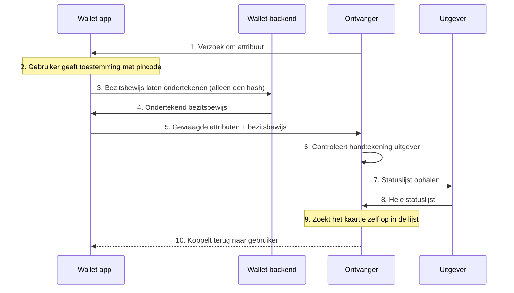

_Vereenvoudigde weergave. De volledige flow staat in de
[NL Wallet-documentatie over disclosure](https://github.com/MinBZK/nl-wallet/blob/main/wallet_docs/architecture/use-cases/disclosure-with-openid4vp.md)._

## Selectieve gegevensdeling

**De wallet stelt je ook in staat een klein stukje data, of een afgeleide van
jouw data te tonen, bijvoorbeeld alleen of iemand 18 jaar of ouder is. Hoe werkt
dat technisch?**

**Sietse**: Technisch gezien heb je een attestatie of credential: een bericht
getekend door de uitgever. In het geval van de PID (Personal Identification
Data) is dat de overheid. Daarin zitten je attributen, maar niet rechtstreeks,
want in plaats daarvan staan ze als gesalte hashes. Als je een attribuut wilt
onthullen, stuur je de waarde én de salt mee. De ontvanger hasht die twee samen
en controleert of het overeenkomt met de hash in de attestatie, die getekend is
door de uitgever.

**Tim**: Er is in dit vakgebied ook het begrip zero-knowledge proofs, en dan
specifiek range proofs. In theorie zou de wallet kunnen berekenen of iemand
18-plus is op basis van de geboortedatum, met een cryptografische truc. Dat zit
nu nog niet in de wallet.

## Open stelsel: hoe sluit je aan?

**Hoe ziet de onboarding eruit voor partijen die willen aansluiten?**

**Sietse**: Het is een open stelsel. Een partij die attributen uit de wallet wil
ontvangen, registreert zich en toont aan dat hij hoort bij het bedrijf dat hij
claimt te zijn. Dat verificatieproces wordt nog ingericht; waarschijnlijk speelt
de KVK daarin een rol. Als dat gedaan is, krijgt de partij een toegangs- en een
registratiecertificaat. Met deze certificaten kan hij attributen ontvangen: ze
worden gepresenteerd aan de wallet, zodat die de verzoekende partij kan
authenticeren én kan controleren of die partij niet om meer gegevens vraagt dan
eerder opgegeven.

**Jacob**: We hebben zelf twee test-componenten gebouwd om het makkelijker te
maken: een
[referentie-uitgever](https://github.com/MinBZK/nl-wallet/tree/main/wallet_core/wallet_server/issuance_server)
en een
[referentie-ontvanger](https://github.com/MinBZK/nl-wallet/tree/main/wallet_core/wallet_server/verification_server).
Die verlagen de drempel als je snel iets wil demonstreren. Maar er zijn ook veel
andere aanbieders van zulke componenten.

### NL Wallet Community

**Tim**: We hebben ook een NL Wallet Community opgezet voor organisaties die
willen experimenteren met wat de NL Wallet in hun bedrijfsprocessen of sector
betekent, zonder dat we daarvoor meteen een grootschalige pilot hoeven te
organiseren. Vanuit het project ondersteunen we die partijen met documentatie en
software. Sommigen gebruiken onze componenten, anderen bouwen hun eigen software
of gebruiken andere componenten. Meer informatie over de NL Wallet Community en
hoe organisaties zich kunnen aanmelden vind je op
[edi.pleio.nl](https://edi.pleio.nl).

## Hoe verloopt de samenwerking met Europa?

**De wallet moet compliant zijn met wat er op Europees niveau wordt bedacht. Hoe
werkt die samenwerking en hoe bouw je features aan de hand van wat er wordt
voorgeschreven?**

**Tim**: Dit loopt over veel sporen en aan veel tafels. Sinds 2021 zijn er
onderhandelingen over de wetgeving. Daarin zit het beleidsdepartement aan tafel,
geïnformeerd door stakeholders en experts. Dat proces gaat vooral over het wát,
niet zozeer het hoe.

De vervolgstap zijn de onderliggende technische specificaties. Daarvoor hebben
we collega's die zich bezighouden met afstemming en die prioritaire punten naar
Europa toe brengen. In februari kregen we bijvoorbeeld een hele set nieuwe
teksten. Die zijn grondig uitgeplozen door experts, feedback is verzameld en
gaat richting Europa. Maar 26 andere lidstaten doen hetzelfde, wat het een
uitdagend proces maakt. We hebben ook nauwe contacten met een paar grote
lidstaten voor proactievere afstemming.

De meer technische details worden uitontwikkeld bij standaardisatieorganisaties.
De ISO heeft jarenlang gewerkt aan een Mobile Driving License-standaard, die in
feite een generieke standaard is voor attestaties. Aan de andere kant is er de
OpenID Foundation, waar we ook input aanleveren. En voor specifieke
stelselzaken, zoals toegangscertificaten, geeft de Europese Commissie opdracht
aan ETSI.

**Sietse**: Er is zeker kruisbestuiving. Het is niet zo dat men iets bedenkt en
dat vervolgens aan ETSI geeft. Er is veel communicatie over en weer. Standaarden
die technisch niet goed in orde zijn, kunnen ervoor zorgen dat doelen op het
gebied van privacy of security niet haalbaar zijn. Daarom wordt er veel met
elkaar gesproken, zodat de standaarden die doelen wel waarmaken.

## Herleidbaarheid bij leeftijdsverificatie

**Er is de laatste tijd veel discussie over leeftijdsverificatie in de context
van sociale media. Mijn vraag is of je zoiets kunt doen op een manier waarbij
een gebruiker niet herleidbaar is. Kan zoiets?**

### Belangrijke kanttekening: wallets zijn vrijwillig

**Tim**: Eerst even een beleidsmatige kanttekening: eIDAS stelt dat wallets
vrijwillig zijn. Als je overal gedwongen wordt je leeftijd te bewijzen en daar
alleen een wallet voor kunt gebruiken, is dat niet vrijwillig.

**Sietse**: De vraag is ook tweeledig: is het wenselijk? En als je het doet, hoe
doe je het dan zo privacyvriendelijk mogelijk? Ik heb het nu alleen over dat
tweede deel.

Je wilt dat alles wat vanuit de wallet naar een ontvanger gaat, geen herleidbare
of unieke elementen bevat. Dat proberen we op meerdere manieren te
bewerkstelligen.

Ten eerste: de wallet toont alleen het ene attribuut "ouder dan 18: ja", en niet
je naam, geboortedatum of woonplaats. Dat is het enige wat de ontvanger ziet. In
Nederland is de voorlopige keuze om dat attribuut niet in de PID (Personal
Identification Data) op te nemen, maar in een aparte attestatie.

Ten tweede: een attestatie is uiteindelijk een set bytes. Als je dezelfde unieke
set bytes twee keer gebruikt, ben je herkenbaar als dezelfde persoon. Dat
voorkomen we door de wallet niet één PID-attestatie op te halen, maar een hele
set kopieën. Zo gebruikt elke presentatie een verse kopie en worden nooit
dezelfde bytes twee keer verstuurd.

**Jacob**: Onze referentie-uitgever rondt ook metadata zoals het tijdstip van
uitgifte af op de dag. Anders zou een ontvanger aan een exacte timestamp kunnen
zien dat twee presentaties van dezelfde uitgifte afkomstig zijn.

**Sietse**: Privacy by design betekent dat je bij elk technisch detail nadenkt:
zit hier iets in waardoor de data herleidbaar wordt? Zo ja, hoe los ik dat op?
Het is een stelsel, dus iedereen moet zijn rol spelen: wij doen ons deel als
wallet, maar een uitgever van kaartjes moet dit ook goed aanpakken.

<Blockquote
  attribution="- Sietse Ringers, architect"
  variation="pink-background"
>
"Privacy by design betekent dat je bij elk technisch detail nadenkt: zit hier
iets in waardoor dit herleidbaar wordt?"
</Blockquote>

## Google-account en Apple-ID: op dit moment nog een afhankelijkheid

**Digitale soevereiniteit is een hot topic. Kun je de NL Wallet ook draaien op
Linux of non-Google Android, zoals GrapheneOS of LineageOS?**

### Voor nu vast aan iOS en Android

**Tim**: Daar werken we aan. Op dit moment werkt onze app alleen voor gebruikers
van de ecosystemen van Google en Apple. Dat heeft te maken met security: de
ecosystemen bieden garanties die voorkomen dat malafide apps worden
geïnstalleerd die een wallet namens jou kunnen activeren zonder dat je dat weet.

Er zijn ook andere mogelijkheden om dit te bereiken. De vraag is alleen nog hoe
goed en vooral veilig die mogelijkheden zijn. De wallet is nog in ontwikkeling.
Met een backlog maak je altijd keuzes over de volgorde van ontwikkeling. We
hebben eerst iets gebouwd voor die twee ecosystemen met de meeste gebruikers,
maar we gaan nog voor livegang kijken of we ook de nodige veiligheidsgaranties
kunnen krijgen in andere ecosystemen.

### Hardware bindt de wallet aan jouw telefoon

**Sietse**: Er zijn twee soorten garanties. De eerste: de chip in je telefoon,
de _secure enclave_, zorgt dat sleutelmateriaal gebonden is aan de hardware van
die specifieke telefoon. Zonder die garantie kun je een wallet simpelweg
kopiëren naar een andere telefoon, en dan kun je niet aantonen dat de gegevens
op de telefoon staan die bij de persoon horen.

:::info[Wat is een secure enclave?]

Een secure enclave is een **afgeschermde chip** in je telefoon die volledig
geïsoleerd werkt van het besturingssysteem. Sleutels worden erin aangemaakt en
verlaten de enclave nooit: cryptografische bewerkingen vinden plaats binnen de
enclave zelf, zodat je er zelfs niet van uit een gecompromitteerd
besturingssysteem bij kan.

:::
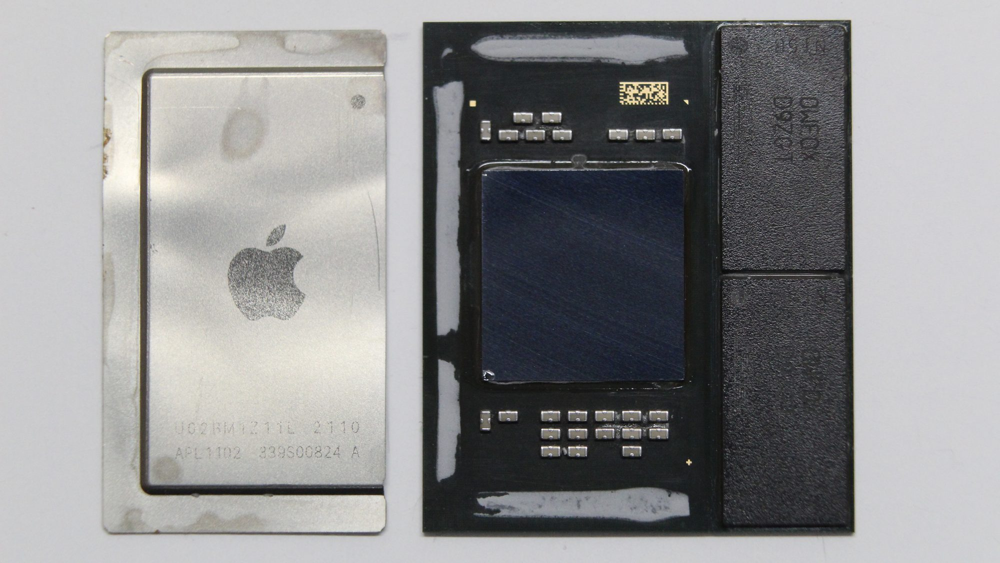
_De Secure Enclave is een extra beschermd deel van Apple-processors, en bestaat
sinds de A7-chip. Op de foto: de Apple M1 met losgehaalde heatspreader, die ook
een Secure Enclave heeft. (Afbeelding: Sonic8400 via [Wikimedia
Commons](https://commons.wikimedia.org/wiki/File:Apple_M1_-_APL1102_-_IHS_removed.jpg),
[CC0](https://creativecommons.org/publicdomain/zero/1.0/deed.nl))_

Het binden van de telefoon aan de persoon en aan de app met gegevens is een van
de factoren die de wallet betrouwbaar maken: in dit geval een bezitsfactor. Die
garantie wordt niet exclusief door Android geboden; ook GrapheneOS of LineageOS
kunnen haar bieden, of ze kan op een andere manier worden ingezet. Het gaat dus
niet zozeer om de software, maar om de hardware die in de telefoon zit. Als je
voldoende goede hardware hebt, dan kun je ook iets anders dan Android op de
telefoon zetten en heel ver komen met de aanwezige secure enclave.

### Is de app-image integer?

De tweede garantie is moeilijker: de authenticiteit van de app zelf. Als onze
backend een verzoek ontvangt, wil hij weten: is dit de authentieke NL Wallet-app
zoals wij die in de Play Store hebben gezet? Of doet een malafide partij
zichzelf voor als de app? Daarvoor bestaan nu alleen Play Integrity (Android) en
App Attest (iOS). Als je die wil gebruiken, zit je vast aan die twee
ecosystemen.

### Andere landen kijken ook naar alternatieven

**Tim**: We hebben op dit moment nog geen uitvoerig onderzoek gedaan naar
alternatieven, maar we zien wel dat andere landen, zoals Zwitserland en
Duitsland, hier ook interesse in hebben. Daarover wisselen we dan ook van
gedachten.

**Jacob**: Wij als developers zien onszelf als bewuste gebruikers; we
installeren zelf geen malware. Maar je moet ook de gemiddelde gebruiker
beschermen. Voor gebruikers die bewust kiezen voor een ander besturingssysteem
en weten wat ze doen, zou je in de toekomst een andere afweging kunnen maken.

### Discussie in de open source community

Door alle zorgen die spelen rondom de kant die Android op gaat, en de macht die
Google hiermee naar zich toe trekt, is er veel input omtrent het mogelijk maken
van gebruik van de wallet op meer open besturingssystemen. Een Github issue dat
erover is gestart heeft inmiddels
[33 comments](https://github.com/MinBZK/nl-wallet/issues/34). Het levert een
mooi inkijkje in hoe de discussie zich heeft ontwikkelt. Ook toont het aan hoe
belangrijk het is om een app als deze open source te ontwikkelen, zodat mensen
met inhoudelijke kennis zich al vroeg in het proces kunnen mengen over
oplossingsrichtingen.

### Kamervragen

Vanuit de Tweede Kamer zijn er ook stemmen die zich hard maken voor het mogelijk
maken van gebruik van de wallet zonder Google-account of Apple-ID. Zo stelde
Barbara Kathmann (PRO) er
[Kamervragen](https://www.tweedekamer.nl/kamerstukken/kamervragen/detail?id=2026Z12033&did=2026D36098)
over waarin ze stelt dat alle Nederlanders, ongeacht welke OS zij gebruiken, de
app zouden moeten kunnen gebruiken.

## Rust en Flutter in de praktijk

**Waarom hebben jullie gekozen voor Rust en Flutter? En hoe werkt dat in de
praktijk?**

**Jacob**: Over het algemeen zijn we er vrij blij mee. Een groot voordeel is dat
we backend services schrijven in dezelfde taal als de core: Rust. We kunnen
daardoor veel code hergebruiken. Rust compileert naar native code, wat goed
werkt op mobiele apparaten. Met Flutter ontwikkel je één keer en heb je een UI
voor twee platforms. Op een paar uitzonderingen na werkt de integratie via
Flutter Rust Bridge goed.

**Sietse**: Rust heeft een sterke focus op correctheid en veiligheid, wat
perfect past in dit domein. Het helpt ons enorm om robuuste software te bouwen.
En dicht bij C zitten is ook handig voor de integratie met HSM's.

:::info[Wat is een HSM?]

Een HSM (Hardware Security Module) is een centrale sleutelcomputer aan de
serverkant. Net als de secure enclave-chip op je telefoon is het een component
waarin sleutels gegenereerd kunnen worden, maar waar ze er nooit uitgehaald
kunnen worden. Die centrale HSM beheert dus alle private keys van alle
attestaties van alle NL Wallets.

De backend vraagt de HSM een challenge te ondertekenen: een willekeurige,
eenmalige waarde van de dienstverlener. De HSM geeft alleen de handtekening
terug, nooit de sleutel. Omdat de challenge elke keer anders is, bewijst een
geldige handtekening dat de legitieme gebruiker op dat moment toegang heeft tot
de sleutel.

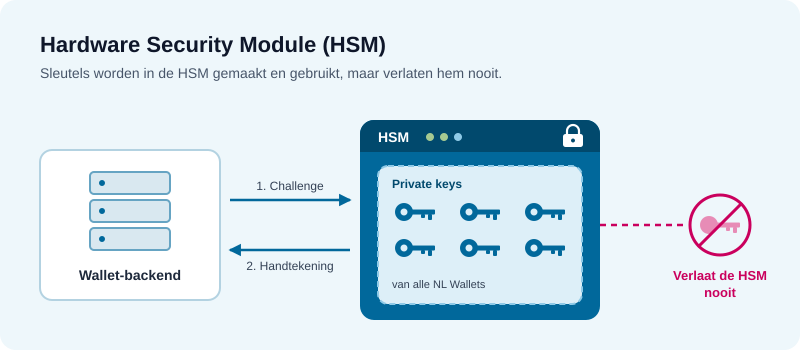
_Schematische weergave door Claude Opus 5.5_

:::

**Jacob**: Een bijkomend voordeel van Rust: voor cryptografie zijn er altijd al
libraries beschikbaar. Voor protocollen is dat soms minder vanzelfsprekend, zo
hebben we gemerkt.

## Aan de slag

**Wat willen jullie meegeven aan developers die dit lezen?**

**Jacob**: Probeer het gewoon uit. Er is heel veel online te vinden en het wordt
steeds beter. Een verifier schrijven en kijken of je een attribuut uit de wallet
kunt plukken is een mooie eerste stap. We hebben ook meegedaan aan het Fieldlab;
het is verrassend met welke use cases mensen komen als ze niet langer gebonden
zijn aan bestaande kaders.

De protocollen, zoals Selective Disclosure JWT (SD-JWT), zijn ook relatief
nieuw. Het is leuk om die te proberen.

---

Wil je experimenteren met de NL Wallet? Sluit je aan bij de
[NL Wallet Community](https://edi.pleio.nl/page/view/0c9b8ee6-cadc-4b2b-b84f-5d27cd264b1e/nl-wallet-community)
of bekijk de broncode op [GitHub](https://github.com/MinBZK/nl-wallet).
