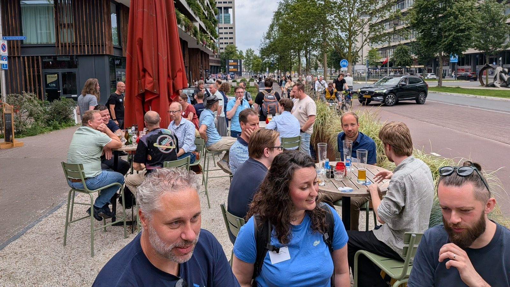

# Onze meetup op 15 december: AI zonder lock-in, OpenLint en de roadmap voor 2027

Hoe bouw je AI-tooling zonder vendor lock-in? Waarom draait de API-linter van de
overheid niet meer op Spectral? En wat staat er in 2027 op de roadmap van
developer.overheid.nl? Op 15 december tijdens onze meetup in Utrecht krijg je
antwoorden op al deze vragen.

Wat je kunt verwachten: geen beleidsverhalen maar concrete praktijkvoorbeelden,
demo's, open source tooling en directe lessen van mensen die hier dagelijks aan
werken.

<!-- truncate -->

:::success[TL;DR]

We organiseren 15 december een meetup in Utrecht met hands-on demo's en
praktijkvoorbeelden. Aanmelden kan via
[opensourcewerken.nl](https://opensourcewerken.nl/events/view/8dfe1365-3742-4832-8359-f2efed31126a/developeroverheidnl-meetup-samenbeterbouwen)
of mail naar [v.vanderheijden@geonovum.nl](mailto:v.vanderheijden@geonovum.nl).

:::

## Op het programma

12:30 – 13:00 · **Inloop en lunch**

### Opening en welkom

13:00 – 13:10 · **Tom Ootes**, developer advocate bij developer.overheid.nl en
code.overheid.nl

### LLM's en model-agnostische tooling

13:15 – 13:40 · **Oscar Lepoeter**, AI Lead bij het Delta Instituut

Oscar neemt jullie mee in waar LLM's nu staan, vanuit Nederlands en Europees
perspectief. Tijdens zijn werk gebruikt hij dagelijks AI voor knowledge
management, met zelfgebouwde skills. Ook vertelt hij hoe je zelf
model-agnostische tooling bouwt om privacy- en soevereiniteitsrisico's te
vermijden.

### Community-update code.overheid.nl

13:45 – 14:10 · **Tom Ootes**, developer advocate, en **Jan Klopper**, security
expert

Code.overheid.nl ontwikkelt zich van een platform om code te publiceren naar een
plek om samen software te bouwen. Tom en Jan vertellen over CI/CD-runners, een
eigen containerregistry, federatie tussen verschillende instanties en de
Europese samenwerking rond git-forges.

14:10 – 14:25 · **Pauze**

### OpenLint, een open specificatie voor API-linting

14:25 – 14:50 · **Joost Farla**, maintainer van OpenLint en
implementatieondersteuner bij Geonovum

De API Design Rules-linter van developer.overheid.nl draait sinds kort op
OpenLint, een community-fork van Spectral. Joost vertelt waarom OpenLint het
Spectral-formaat vastlegt in een open specificatie met conformancetests, en wat
dit betekent voor bestaande rulesets, waaronder die van de overheid.

### Van prompt naar productie: overheids-API's die aan de regels voldoen

14:55 – 15:20 · **Dimitri van Hees**, product owner en developer advocate bij
developer.overheid.nl

Dimitri laat aan de hand van één API zien hoe tools en registers developers
helpen om overheidsstandaarden toe te passen. De keten loopt van AI-skills en
herbruikbare schema's tot gegenereerde OpenAPI-startcode, linting en publicatie
in de nationale API- en OSS-registers. De stappen werken ook zonder AI-agent.

### Roadmap 2027 voor developer.overheid.nl

15:25 – 15:50 · **Anne Schuth**, product owner van developer.overheid.nl en
code.overheid.nl vanuit de Nederlandse Digitale Dienst

Developer.overheid.nl verschuift van informatie opzoeken naar platform
engineering: gedeelde tooling, gestandaardiseerde bouwstenen en agent-skills met
kennis van overheidsstandaarden. De eerste skills staan online.

Anne licht de verschuiving en de roadmap toe en hoort graag waar developers in
hun dagelijkse werk tegenaan lopen. Dit is het moment om mee te denken: de
roadmap wordt jaarlijks op hoofdlijnen vastgesteld.

15:50 – 16:00 · **Wrap-up**

Vanaf 16:00 · **Borrel bij Ruig**

## Praktische informatie

|              |                                                                                                                                                                                                                                    |
| ------------ | ---------------------------------------------------------------------------------------------------------------------------------------------------------------------------------------------------------------------------------- |
| 📅 Datum     | Dinsdag 15 december 2026                                                                                                                                                                                                           |
| 🕒 Tijd      | 12:30 tot 16:00 (aansluitend borrel bij Ruig)                                                                                                                                                                                      |
| 📍 Locatie   | Meetup Utrecht (boven het Beatrixtheater)                                                                                                                                                                                          |
| ✉️ Aanmelden | Via [opensourcewerken.nl](https://opensourcewerken.nl/events/view/8dfe1365-3742-4832-8359-f2efed31126a/developeroverheidnl-meetup-samenbeterbouwen) of mail naar [v.vanderheijden@geonovum.nl](mailto:v.vanderheijden@geonovum.nl) |

 

👉 Wat wil jij zien, leren of delen?  👉 Waar heb jij behoefte aan?

Word contributor.

We zien je op 15 december!
