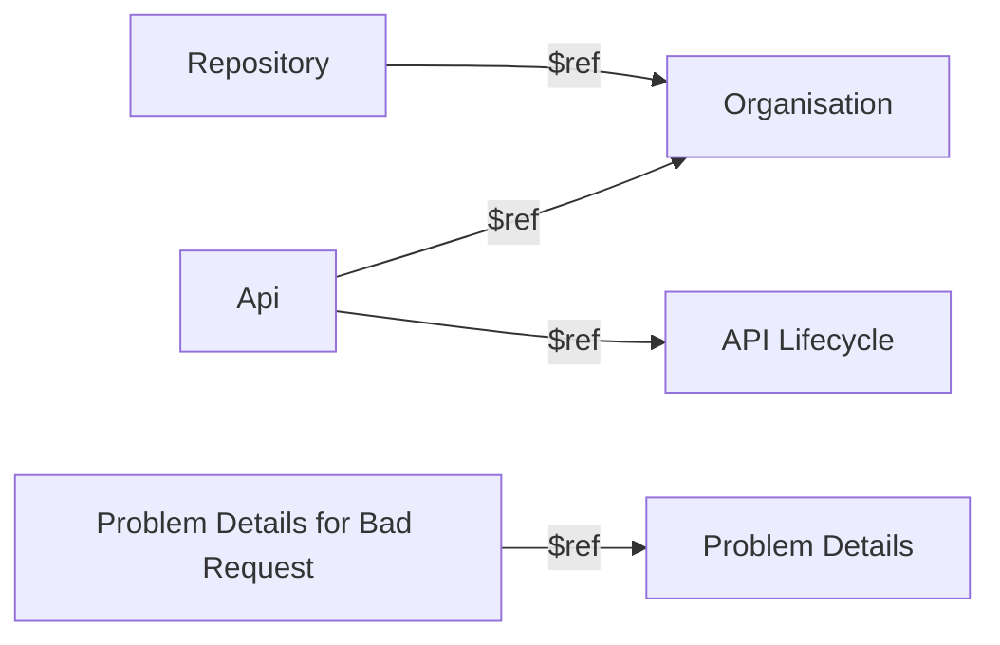

---
description:
  "Het Schema-register van developer.overheid.nl is live. Je vindt er JSON
  Schema's om te hergebruiken, met per schema een health-score, de dependencies
  en een gebundelde versie. Het register is nog in bèta, want hoe een goed
  schema eruitziet, spreken we samen af in de nieuwe werkgroep Schema Design
  Rules."
authors: [dimitri-van-hees]
tags:
  - json-schema
  - openapi
  - oas
  - api-design
  - kennisplatform-apis
  - standaarden
draft: false
---

# Het Schema-register: herbruikbare JSON Schema's voor API's, tools en AI

Naast het [API-register](https://apis.developer.overheid.nl) en het
[OSS-register](https://oss.developer.overheid.nl) hebben we er een register bij:
het [Schema-register](https://schemas.developer.overheid.nl). Hier vind je JSON
Schema's die je kunt hergebruiken in je eigen API's, berichten en tooling. Het
register is nog in bèta, want de afspraken over hoe een goed schema eruitziet
moeten nog gemaakt worden. Dat gaan we met de nieuwe werkgroep "Schema Design
Rules" van het Kennisplatform API's verder uitwerken. In deze blog lees je
waarom JSON Schema juist nú zo belangrijk is, wat het register allemaal kan en
hoe je kunt bijdragen.

<!-- truncate -->

## Waarom JSON Schema?

Het idee voor een Schema-register is niet nieuw. Toen we in maart 2025
[de nieuwe versie van developer.overheid.nl](/blog/2025/03/13/nieuwe-versie-developer-overheid-nl)
aankondigden, noemden we `schemas.developer.overheid.nl` al als mogelijke plek
voor herbruikbare schema's. Een paar maanden later, in onze blogpost over
[OpenAPI 3.1](/blog/2025/07/10/openapi-31-in-zicht), schreven we dat er naast de
API Design Rules waarschijnlijk ook "JSON Schema Design Rules" moesten komen, en
dat we daarvoor goed zouden kijken naar het schema-register van de Britse DVLA.
Het register staat er nu, en aan de regels wordt gewerkt.

### OpenAPI 3.1

Dat het juist nú komt, heeft alles te maken met OpenAPI 3.1. Per 1 januari 2027
is dat de verplichte standaard voor API's van de overheid. Waar OAS 3.0 nog een
eigen schema gebruikte, ondersteunt 3.1 "JSON Schema 2020-12" volledig. Daardoor
kun je vanuit je OpenAPI-document met een `$ref` verwijzen naar een JSON Schema
dat iemand anders al heeft gemaakt, en kun je alle tooling gebruiken die er voor
JSON Schema bestaat. Met het Schema-register hebben we één plek waar die
schema's te vinden en te hergebruiken zijn.

### Meer dan API's

JSON Schema is echter veel meer dan het `schema`-veld in een OpenAPI-document.
Dezelfde schema's beschrijven berichten in [AsyncAPI](https://www.asyncapi.com)
en de gegevens in een
[CloudEvent](/kennisbank/api-ontwikkeling/standaarden/cloudevents). Validators
toetsen er gegevens mee, en generators maken er TypeScript-types, Java-classes,
formulieren en documentatie van. Overal waar gegevensuitwisseling tussen
systemen plaatsvindt, kan een JSON Schema vastleggen hoe die gegevens eruitzien.
Een schema uit het register is dus niet alleen bruikbaar voor wie een API bouwt.

### Tools in the loop

In het huidige AI-tijdperk wordt dat alleen maar belangrijker. In
[Tools in the loop](/blog/2026/07/2/tools-in-the-loop) schreven we dat je naast
de mens ook de _tools_ in de loop moet houden: generators die het zware werk
doen en validators die de regels bewaken. Een JSON Schema is precies zo'n vaste
set regels. Een taalmodel genereert plausibel ogende code en data, maar of die
klopt, beantwoordt een validator met een schema, niet het model. En een agent
die een API bouwt, hoeft een adres of een organisatie niet zelf te verzinnen als
hij in het register kan vinden wat er al is. Dat scheelt hallucinaties, en het
scheelt tokens.

Dat werkt alleen als schema's eenduidig zijn. Een schema zonder `title` of
`description` begrijpt een agent net zo slecht als een mens, en elke
inconsistentie in een schema komt terug in alles wat je ermee genereert.

## Wat we tegenkwamen

Om te zien waar we staan, hebben we op een testomgeving een experiment gedaan.
Uit alle API's in het API-register hebben we elk schema geëxtraheerd, ook de
geneste en inline schema's. Dat is niet hoe we het register willen vullen, maar
het werkt wel als spiegel. Wat we zagen:

- veel schema's zonder `title` of `description`, waardoor niet duidelijk is wat
  ze voorstellen
- foutmeldingsschema's in talloze varianten, terwijl
  [Problem Details](https://www.rfc-editor.org/rfc/rfc9457) er één keer zou
  moeten zijn
- `examples` die niet kloppen met het type, zoals een getal bij `type: string`
- veel schema's met dezelfde structuur, maar andere annotaties

### Zelfde structuur, andere annotaties

Dat laatste is een mooi voorbeeld van waar afspraken helpen. Een GeoJSON Polygon
voor de contour van een gebouw en die voor een postcodegebied hebben precies
dezelfde structuur. Alleen de `description` en de `examples` verschillen, en dus
staan ze er als losse schema's in.

Dat kan anders. In JSON Schema draft 7 en ouder, en dus ook in OpenAPI 3.0, werd
alles naast een `$ref` genegeerd, en moest je er een `allOf` omheen zetten om er
een eigen `description` bij te geven. Sinds JSON Schema 2019-09 is `$ref` een
gewoon keyword dat naast andere keywords mag staan, en omdat OpenAPI 3.1 JSON
Schema 2020-12 gebruikt, kun je dat nu ook in je OpenAPI-document toepassen. Zo
leg je de structuur één keer vast in een minimaal schema:

```json title="Polygon.schema.json"
{
  "$schema": "https://json-schema.org/draft/2020-12/schema",
  "title": "Polygon",
  "description": "Een GeoJSON Polygon",
  "type": "object",
  "required": ["type", "coordinates"],
  "properties": {
    "type": { "const": "Polygon" },
    "coordinates": {
      "type": "array",
      "items": {
        "type": "array",
        "minItems": 4,
        "items": {
          "type": "array",
          "minItems": 2,
          "items": { "type": "number" }
        }
      }
    }
  }
}
```

En hergebruik je die structuur in je eigen schema's, elk met een eigen
betekenis:

```json title="Gebouw.schema.json"
{
  "$schema": "https://json-schema.org/draft/2020-12/schema",
  "title": "Gebouw",
  "description": "Een gebouw",
  "type": "object",
  "properties": {
    "contour": {
      "$ref": "./Polygon.schema.json",
      "description": "De contour van het gebouw"
    }
  }
}
```

```json title="Postcodegebied.schema.json"
{
  "$schema": "https://json-schema.org/draft/2020-12/schema",
  "title": "Postcodegebied",
  "description": "Het gebied dat bij een postcode hoort",
  "type": "object",
  "properties": {
    "gebied": {
      "$ref": "./Polygon.schema.json",
      "description": "De grens van het postcodegebied"
    }
  }
}
```

Zonder afspraken krijg je tientallen manieren om een adres te modelleren, en
schrijft elke afnemer eigen code om ze om te zetten. Een schema dat je niet
begrijpt, hergebruik je niet, en een AI-agent ook niet. Een register vol
varianten is geen register, maar een archief.

## Het Schema-register

Het register draait op [Sourcemeta One](https://one.sourcemeta.com), met een
eigen front-end in de stijl van developer.overheid.nl. Het begint met twee
collecties: de schema's uit de API Design Rules, zoals Problem Details, en
herbruikbare schema's van developer.overheid.nl zelf, zoals `Organisation`,
`Api` en `Repository`. Je kunt zoeken op titel en filteren op type en JSON
Schema-dialect.

### Schema's bekijken en gebruiken

Per schema zie je:

- de beschrijving en een tabel met alle eigenschappen, inclusief type, of ze
  verplicht zijn en het `format`
- het schema zelf, ook als gebundelde versie waarin alle verwijzingen zijn
  opgenomen, en een link om het te openen in de JSON Schema Viewer
- de dependencies van het schema
- een health-score met de gevonden health issues

### Dependencies

Het register laat de dependencies in twee richtingen zien: naar welke schema's
een schema verwijst, en welke schema's ernaar verwijzen. Neem het schema
`Organisation`, dat een overheidsorganisatie aanduidt met haar
[TOOI](https://standaarden.overheid.nl/tooi)-identifier. In het register zie je
direct dat de schema's `Api` en `Repository` ernaar verwijzen. Pas je
`Organisation` aan, dan weet je dus ook welke schema's daar last van kunnen
hebben.



### Health

Elk schema krijgt een health-score, uitgedrukt in een percentage. Daaronder
staan de gevonden health issues, elk met een JSON pointer naar de plek in het
schema waar het om gaat. Zo zie je niet alleen dát er iets schort, maar ook
precies waar. Op het moment van schrijven vindt het register onder meer:

- **Geen `examples` op het hoogste niveau.** Bijna elk schema in het register
  heeft dit issue. Zonder voorbeeld moet een mens, of een agent, raden hoe
  geldige gegevens eruitzien.
- **Een `description` die eindigt met een punt.** De regel gaat ervan uit dat
  een gebruikersinterface zelf bepaalt hoe de tekst wordt getoond, en dan zit
  een punt in de weg.
- **`type` naast `enum`.** Als de toegestane waarden al vastliggen, volgt het
  type daaruit. Het schema `API Lifecycle` doet dat bijvoorbeeld bij `status`.
- **Een `$ref` verpakt in een `allOf`.** Dat was alleen nodig in draft 7 en
  ouder. Sinds 2019-09 mag een `$ref` gewoon naast andere keywords staan, zoals
  bij de Polygon hierboven. `Problem Details for Bad Request` krijgt dit issue.

Deze regels komen op dit moment uit de ingebouwde set van Sourcemeta One. Dat is
een goed startpunt, maar het zijn niet de afspraken van de overheid. Daarover
straks meer.

### Bèta

Op elke pagina van het register staat een melding:

> Het Schema-register is in beta: kopieer een schema voordat je het in productie
> gebruikt.

URL's, bestandsnamen en versionering worden onderdeel van de Schema Design
Rules, en die zijn nog niet vastgesteld. Een `$ref` naar het register is daarom
nog niet stabiel. Tijdens het ontwerpen kun je er gerust naar verwijzen, maar
haal het schema binnen of bundel het voordat je het in productie gebruikt.

## Schema Design Rules

Om de wildgroei aan te pakken is er een nieuwe werkgroep van het
[Kennisplatform API's](/kennisbank/api-ontwikkeling/communities/kennisplatform-apis/):
de werkgroep Schema Design Rules. De kick-off was op 28 oktober bij Geonovum,
met deelnemers van Geonovum, Gemeente Amsterdam, VNG en Logius.

### Relatie met de API Design Rules

OpenAPI zegt niets over wat er in het `schema`-veld van een request of response
staat, en daardoor zeiden de ADR daar tot nu toe ook weinig over. De ADR kunnen
zeggen "gebruik JSON Schema", de Schema Design Rules zeggen hoe. Daarbij gaan ze
één laag dieper, met dezelfde aanpak:

| Standaard           | Gaat over                                                           |
| ------------------- | ------------------------------------------------------------------- |
| API Design Rules    | URL-paden, queryparameters en het gedrag van een API                |
| Schema Design Rules | Request- en response-bodies, berichten en andere gegevensstructuren |

En omdat JSON Schema veel breder wordt gebruikt dan alleen in OpenAPI, verdient
dat een eigen set afspraken naast de ADR, en niet een hoofdstuk erin.

#### Verhuizen vanuit de ADR

Een aantal onderwerpen die nu bij de ADR liggen, gaat eigenlijk over de gegevens
in bodies. Die kunnen naar de Schema Design Rules verhuizen, waarna de ADR
ernaar verwijzen. Denk aan:

- veldnamen, zoals geen afkortingen en wel of geen Nederlandse naamgeving
- wel of niet de resourcenaam herhalen in een veldnaam
- property casing, dat destijds bij de ADR is geparkeerd
- formats, zoals de OpenAPI Format Registry die de ADR nu gebruiken

Ook een aantal open issues bij de ADR is kandidaat om te verhuizen. Daar is nog
niets over besloten:

| ADR-issue                                                                 | Onderwerp                                               | Schema Design Rules                                    |
| ------------------------------------------------------------------------- | ------------------------------------------------------- | ------------------------------------------------------ |
| [#336](https://github.com/Logius-standaarden/API-Design-Rules/issues/336) | `property-casing` botst met JSON-LD                     | [#699](https://github.com/Geonovum/KP-APIs/issues/699) |
| [#198](https://github.com/Logius-standaarden/API-Design-Rules/issues/198) | `property-casing` uitbreiden                            | [#699](https://github.com/Geonovum/KP-APIs/issues/699) |
| [#341](https://github.com/Logius-standaarden/API-Design-Rules/issues/341) | Eenduidige semantiek voor `null` en afwezige properties | nog geen issue                                         |
| [#289](https://github.com/Logius-standaarden/API-Design-Rules/issues/289) | `date-time` nauwkeuriger dan seconden                   | [#694](https://github.com/Geonovum/KP-APIs/issues/694) |

### Werkwijze

We beginnen klein, met een versie 0.1 met concrete regels. We werken zoals bij
de ADR: één issue per onderwerp, elk issue begint met een concreet voorstel, en
de regels worden uitgewerkt in rulesets die we met
[OpenLint](/blog/2026/11/04/openlint-vervangt-spectral) kunnen toetsen. Het
register en de regels staan daarbij los van elkaar. Een regel moet ook buiten
het register te onderbouwen zijn.

Er staan al issues klaar. Een paar onderwerpen hebben al een concreet voorstel,
zoals een verplichte
[`title` en `description`](https://github.com/Geonovum/KP-APIs/issues/687),
[examples die valideren](https://github.com/Geonovum/KP-APIs/issues/689) tegen
het schema en
[externe `$ref`s die resolven](https://github.com/Geonovum/KP-APIs/issues/691).
Andere onderwerpen zijn lastiger, zoals
[versionering](https://github.com/Geonovum/KP-APIs/issues/692),
[custom extensions en annotaties](https://github.com/Geonovum/KP-APIs/issues/693)
en
[veldnamen en property casing](https://github.com/Geonovum/KP-APIs/issues/699).

### Van regels naar score

Zodra de Schema Design Rules er zijn en in een ruleset staan, kunnen we de
health-score in het register daarop gaan baseren, net zoals de ADR-score in het
API-register laat zien in hoeverre een API aan de API Design Rules voldoet. Dan
zegt de score niet alleen of een schema technisch netjes is, maar ook of het
voldoet aan wat we binnen de overheid hebben afgesproken. Niet toevallig zijn
"geschikt voor AI" en "productieklaar" twee van de toetsstenen die de werkgroep
voor elke regel hanteert.

## Een schema toevoegen

Heb je een schema dat anderen kunnen hergebruiken? Voeg het toe met een pull
request op
[developer-overheid-nl/don-static](https://github.com/developer-overheid-nl/don-static/tree/main/assets/schemas).
Geef het een bestandsnaam als `<Naam>.schema.json`, en zorg in ieder geval voor
een `$schema`, een `$id`, een `title` en een `description`. Vermeld in de pull
request bij welke organisatie het schema hoort en wie het beheert. De
[README](https://github.com/developer-overheid-nl/don-static/tree/main/assets/schemas)
beschrijft de huidige werkwijze. Ook die is nog geen standaard, maar een
startpunt voor de werkgroep.

We zoeken daarnaast schema's om de regels aan te toetsen. We kijken nu onder
meer naar Problem Details, CloudEvents, de basisregistraties, de schema's van
VNG en geoschema's van PDOK, Geonovum, OGC en Kadaster. Heb je schema's uit een
ander domein, ook als ze nu nog onderdeel zijn van een OpenAPI-document, dan
horen we dat graag. Hoe breder de toetsset, hoe beter de regels.

## Meedenken over de Schema Design Rules?

De discussie over de Schema Design Rules voeren we op GitHub, zodat iedereen kan
meelezen en meedoen. Reageer op de
[bestaande issues](https://github.com/Geonovum/KP-APIs/issues?q=label%3A%22WG%3A%20Schema%20design%20rules%22)
of maak zelf een issue aan. Wil je aansluiten bij de werkgroep of op de hoogte
blijven? Stuur een mailtje naar [api@geonovum.nl](mailto:api@geonovum.nl). Heb
je vragen of ideeën over het register zelf, laat het dan weten in
[#developer-overheid.nl](https://codefornl.slack.com/archives/CFV4B3XE2) op de
Slack van Code for NL of mail naar
[developer.overheid@geonovum.nl](mailto:developer.overheid@geonovum.nl)!
