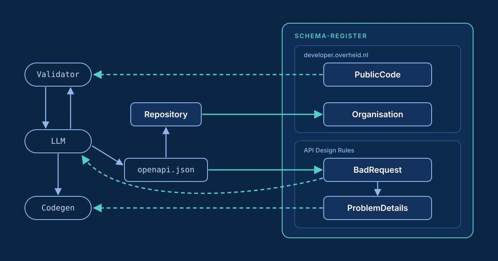
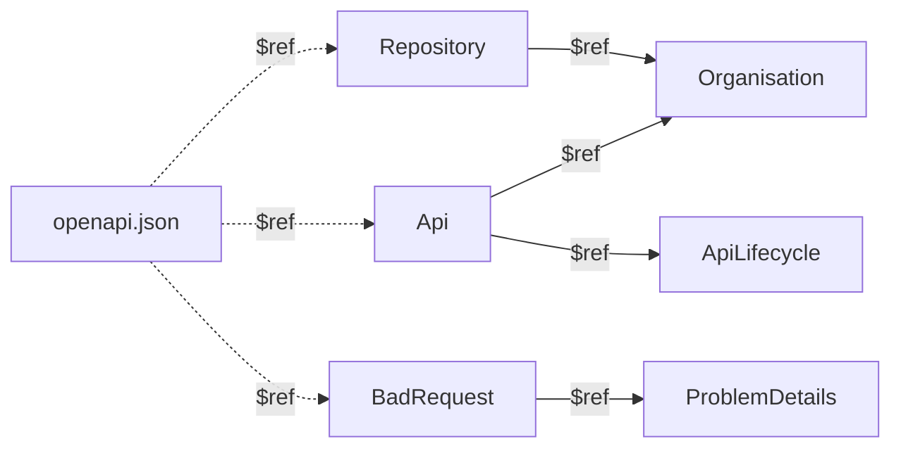

---
description:
  "Het Schema-register van developer.overheid.nl is live. Je vindt er JSON
  Schema's om te hergebruiken, met per schema een health-score, de dependencies
  en een gebundelde versie. Het register is nog in bèta, want hoe een goed
  schema eruitziet, spreken we samen af in de nieuwe werkgroep Schema Design
  Rules."
authors: [dimitri-van-hees]
tags:
  - interoperabiliteit
  - ai
  - json-schema
  - openapi
  - adr
  - api-design
  - linked-data
  - kennisplatform-apis
draft: true
image: ./img/schema-register.png
---

# Het nieuwe Schema-register: herbruikbare JSON Schema's voor API's, tools en AI



Naast het [API-register](https://apis.developer.overheid.nl) en het
[OSS-register](https://oss.developer.overheid.nl) hebben we er een register bij:
het [Schema-register](https://schemas.developer.overheid.nl). Hier vind je JSON
Schema's die je kunt hergebruiken in je eigen API's, berichten en tooling. Het
register is nog in bèta, want uniforme afspraken over hoe overheidsschema's
eruitzien moeten nog gemaakt worden. Dat gaan we met de nieuwe werkgroep "Schema
Design Rules" van het Kennisplatform API's verder uitwerken. In deze blog lees
je waarom JSON Schema juist nú zo belangrijk is, wat het register allemaal kan
en hoe je kunt bijdragen.

<!-- truncate -->

## Waarom JSON Schema?

[JSON Schema](https://json-schema.org) is een populaire standaard om de
structuur van JSON-documenten te beschrijven en te valideren (voor de XML'ers
onder ons: XSD voor JSON, zeg maar). Je legt er bijvoorbeeld in vast welke
velden een adres heeft, welke daarvan verplicht zijn en welk type of formaat elk
veld heeft. Daarnaast kun je er annotaties in kwijt, zoals een `description` en
`examples`. Die zeggen niets over de structuur, maar helpen een ontwikkelaar
begrijpen wat een veld betekent en hoe geldige gegevens eruitzien. Goed voor de
Developer Experience dus.

### OpenAPI 3.1

Dat we juist nú met een Schema-register komen, heeft alles te maken met
[OpenAPI 3.1](/blog/2025/07/10/openapi-31-in-zicht). Per 1 januari 2027 is dat
de verplichte standaard voor API's van de overheid. Waar OAS 3.0 nog een eigen
schema gebruikte, is 3.1 volledig compliant met "JSON Schema 2020-12". Daardoor
kun je vanuit je OpenAPI-document met een `$ref` verwijzen naar een bestaand
JSON Schema (al dan niet van iemand anders), en kun je alle tooling gebruiken
die er voor JSON Schema bestaat. Met het Schema-register hebben we één plek waar
die schema's te vinden en te hergebruiken zijn.

### Meer dan API's

JSON Schema is echter veel meer dan het `schema`-veld in een OpenAPI-document.
Dezelfde schema's beschrijven berichten in
[AsyncAPI](/kennisbank/api-ontwikkeling/standaarden/asyncapi) en de gegevens in
een [CloudEvent](/kennisbank/api-ontwikkeling/standaarden/cloudevents).
Validators checken er gegevens mee, en generators maken er TypeScript-types,
Java-classes, formulieren en documentatie van. Overal waar gegevensuitwisseling
tussen systemen plaatsvindt, kan een JSON Schema vastleggen hoe die gegevens
eruitzien, inclusief een beschrijving en voorbeelden. Een schema uit het
register is dus niet alleen bruikbaar voor wie een API bouwt, maar ook voor wie
berichten uitwisselt, gegevens valideert of code genereert.

### Tools in the loop

In het huidige AI-tijdperk wordt dat alleen maar belangrijker. In onze blogpost
["Tools in the loop"](/blog/2026/07/2/tools-in-the-loop) schreven we dat je
naast de mens ook _tools_ in de loop moet houden als je met AI werkt: generators
die het zware werk doen en validators die de regels bewaken. Die regels kunnen
verschillende vormen hebben. De API Design Rules staan bijvoorbeeld in een
[OpenLint](/blog/2026/11/04/openlint-vervangt-spectral)-ruleset, en voor de
structuur van gegevens is er JSON Schema. Een taalmodel genereert plausibel
ogende code en data, maar of die data klopt, beantwoordt een validator met een
schema, niet het model. En een agent die een API bouwt, hoeft een adres of een
organisatie niet zelf te verzinnen als hij in het register kan vinden wat er al
is. Dat scheelt hallucinaties, en het scheelt tokens.

Dat werkt alleen als schema's eenduidig zijn. Een schema zonder `title` of
`description` begrijpt een agent net zo slecht als een mens, en elke
inconsistentie in een schema komt terug in alles wat je ermee genereert.

## Het Schema-register

Het register begint met twee collecties: de schema's uit de API Design Rules,
zoals
[Problem Details](/kennisbank/api-ontwikkeling/standaarden/api-design-rules/hoe-te-voldoen/error-handling-problem-details),
en herbruikbare schema's van developer.overheid.nl zelf, zoals `Organisation`,
`Api` en `Repository`. Je kunt zoeken op titel en filteren op type en JSON
Schema-dialect.

### Schema's bekijken en gebruiken

Per schema zie je:

- de beschrijving en een tabel met alle eigenschappen, inclusief type, of ze
  verplicht zijn en het `format`
- het schema zelf, ook als gebundelde versie waarin alle verwijzingen zijn
  opgenomen
- de dependencies van het schema
- een health-score met de gevonden health issues (daarover hieronder meer)

### OpenAPI components

Herbruikbare bouwstenen zijn niet nieuw. Bij de ADR horen al herbruikbare
OpenAPI components, zoals de `API-Version`-header en standaardresponses als
`BadRequest` en `NotFound`. Die hosten we op static.developer.overheid.nl, zodat
je er vanuit je eigen OpenAPI-document met een `$ref` naar kunt verwijzen in
plaats van ze te kopiëren:

```yaml
$ref: "https://static.developer.overheid.nl/openapi-components/adr/2.2/common.yaml#/components/responses/BadRequest"
```

Het verschil zit in wat je hergebruikt. Headers en responses zijn
OpenAPI-begrippen, die je alleen in een OpenAPI-document kunt gebruiken. Een
JSON Schema beschrijft alleen de gegevens zelf, en is daardoor ook bruikbaar in
AsyncAPI, in een CloudEvent of in een validator.

De twee vullen elkaar dus aan. De responses in de components verwijzen voor hun
body met een `$ref` naar het schema van Problem Details:

```yaml title="common.yaml"
BadRequest:
  description: Bad request
  content:
    application/problem+json:
      schema:
        $ref: "https://static.developer.overheid.nl/schemas/adr/2.2/ProblemDetails.schema.json"
```

Zowel de components als het schema hebben de versie van de ADR in hun URL. Dat
is precies waar het bij hergebruik om draait: een `$ref` is zo betrouwbaar als
de URL waar hij naar wijst.

### Dependencies

Het register laat de dependencies in twee richtingen zien: naar welke schema's
een schema verwijst, en welke schema's ernaar verwijzen. Neem het schema
`Organisation`, dat een overheidsorganisatie aanduidt met haar
[TOOI](https://standaarden.overheid.nl/tooi)-identifier. In het register zie je
direct dat de schema's `Api` en `Repository` ernaar verwijzen. Pas je
`Organisation` aan, dan weet je dus ook welke schema's daar last van kunnen
hebben.



De stippellijnen laten zien dat ook een OpenAPI-document op dezelfde manier naar
deze schema's kan verwijzen.

### Health

Elk schema krijgt een health-score, uitgedrukt in een percentage. Daaronder
staan de gevonden health issues, elk met een JSON pointer naar de plek in het
schema waar het om gaat. Zo zie je niet alleen dát er iets schort, maar ook
precies waar. Op het moment van schrijven vindt het register onder meer:

- **Geen `examples` op het hoogste niveau.** Bijna elk schema in het register
  heeft dit issue. Zonder voorbeeld moet een mens, of een agent, raden hoe
  geldige gegevens eruitzien.
- **Een `description` die eindigt met een punt.** De regel gaat ervan uit dat
  een gebruikersinterface zelf bepaalt hoe de tekst wordt getoond, en dan zit
  een punt in de weg.
- **`type` naast `enum`.** Als de toegestane waarden al vastliggen, volgt het
  type daaruit. Het schema `API Lifecycle` doet dat bijvoorbeeld bij `status`.
- **Een `$ref` verpakt in een `allOf`.** Dat was alleen nodig in draft 7 en
  ouder. In 2020-12 mag een `$ref` gewoon naast andere keywords staan, zoals je
  verderop in het voorbeeld met een Point ziet.
  `Problem Details for Bad Request` krijgt dit issue.

Het plan is om hier straks een score te tonen op basis van de Schema Design
Rules. Zolang die er nog niet zijn, gebruiken we ter inspiratie de standaard
ruleset van [Sourcemeta One](https://one.sourcemeta.com), het platform waar het
register op draait. Dat is een goed startpunt, maar het zijn niet de afspraken
van de overheid.

### Persistente URL's

Een `$ref` werkt alleen zolang de URL waar hij naar wijst blijft bestaan en
dezelfde inhoud teruggeeft. Naamgeving en versionering horen daarom bij elkaar,
en over allebei is de discussie nog in volle gang:

- **Naamgeving.** Het voorstel is `UpperCamelCase.schema.json`, zoals
  `ProblemDetails.schema.json`. Editors als VS Code herkennen de extensie
  `.schema.json` automatisch als JSON Schema. Er is ook een tegengeluid: macOS
  heeft standaard een case-insensitive bestandssysteem, en daarom kiezen veel
  projecten voor alleen kleine letters.
- **Versie in de URL.** Zet je de versie in een map, zoals bij de ADR
  (`adr/2.2/`), of in de bestandsnaam, zoals Gemeente Amsterdam doet met `v1` en
  `v2`? En alleen de major, of de volledige versie?
- **Wat is breaking?** Een veld verwijderen is dat zeker. Een nieuw verplicht
  veld hangt af van wie je bent: voor een hergebruiker van het schema is het
  breaking, voor een afnemer van de API is het een extra veld dat hij kan
  negeren. Tenzij die afnemer strikt deserialiseert, want dan crasht hij op
  onbekende velden.
- **`$id` en hosting.** In JSON Schema is `$id` een identifier, en niet per se
  de plek waar het schema staat. Het register serveert elk schema onder een
  eigen URL. Publiceert een organisatie een schema op haar eigen domein en haalt
  het register het op, welke URL is dan de gezaghebbende?

Een richting die in de kick-off langskwam: immutable URL's per versie, eventueel
aangevuld met URL's op major- of minor-niveau die meebewegen. Wie naar een
immutable URL verwijst, weet zeker dat het schema niet onder zijn voeten
verandert.

## Wat we tegenkwamen

Om te zien waar we staan, hebben we op een testomgeving een experiment gedaan.
Uit alle API's in het API-register hebben we elk schema geëxtraheerd, ook de
geneste en inline schema's. Dat is niet hoe we het register willen vullen, maar
het werkt wel als spiegel. Wat we zagen:

- veel schema's zonder `title` of `description`, waardoor niet duidelijk is wat
  ze voorstellen
- foutmeldingsschema's in talloze varianten, terwijl Problem Details er één keer
  zou moeten zijn
- `examples` die niet kloppen met het type, zoals een getal bij `type: string`
- veel schema's met dezelfde structuur, maar andere annotaties

### Zelfde structuur, andere annotaties

Dat laatste is een mooi voorbeeld van waar afspraken helpen. Een GeoJSON Polygon
voor de contour van een gebouw en die voor een postcodegebied hebben precies
dezelfde structuur. Alleen de `description` en de `examples` verschillen, en dus
staan ze er als losse schema's in.

Dat kan anders. In OpenAPI 3.0 werd alles naast een `$ref` genegeerd en had je
een `allOf` nodig om er een eigen `description` bij te zetten. JSON Schema
2020-12, en dus ook OpenAPI 3.1, ondersteunt dit wel. Ter illustratie met een
simpelere geometrie, een GeoJSON Point. Je legt de structuur één keer vast in
een minimaal schema:

```json title="Point.schema.json"
{
  "$schema": "https://json-schema.org/draft/2020-12/schema",
  "title": "Point",
  "description": "Een GeoJSON Point",
  "type": "object",
  "required": ["type", "coordinates"],
  "properties": {
    "type": { "const": "Point" },
    "coordinates": {
      "type": "array",
      "minItems": 2,
      "items": { "type": "number" }
    }
  }
}
```

En hergebruikt die structuur in je eigen schema's, elk met een eigen betekenis:

```json title="Gebouw.schema.json"
{
  "$schema": "https://json-schema.org/draft/2020-12/schema",
  "title": "Gebouw",
  "description": "Een gebouw",
  "type": "object",
  "properties": {
    "locatie": {
      "$ref": "./Point.schema.json",
      "description": "De locatie van het gebouw"
    }
  }
}
```

```json title="Laadpaal.schema.json"
{
  "$schema": "https://json-schema.org/draft/2020-12/schema",
  "title": "Laadpaal",
  "description": "Een laadpaal voor elektrische voertuigen",
  "type": "object",
  "properties": {
    "locatie": {
      "$ref": "./Point.schema.json",
      "description": "De locatie van de laadpaal"
    }
  }
}
```

Dit soort bevindingen laat zien waarom afspraken nodig zijn. Zonder afspraken
krijg je tientallen manieren om een adres te modelleren, en schrijft elke
afnemer eigen code om ze om te zetten. Een schema dat je niet begrijpt,
hergebruik je niet, en een AI-agent ook niet. Een register vol varianten is geen
register, maar een archief.

## Schema Design Rules

Om de wildgroei aan te pakken is er een nieuwe werkgroep van het
[Kennisplatform API's](/kennisbank/api-ontwikkeling/communities/kennisplatform-apis/):
de werkgroep Schema Design Rules. De kick-off was op 28 oktober bij Geonovum,
met deelnemers van Geonovum, Gemeente Amsterdam, VNG en Logius.

### Relatie met de API Design Rules

OpenAPI zegt niets over wat er in het `schema`-veld van een request of response
staat, en daardoor zeiden de ADR daar tot nu toe ook weinig over. De ADR kunnen
zeggen "gebruik JSON Schema", de Schema Design Rules zeggen hoe. Daarbij gaan ze
één laag dieper, met dezelfde aanpak:

| Standaard           | Gaat over                                                           |
| ------------------- | ------------------------------------------------------------------- |
| API Design Rules    | URL-paden, queryparameters en het gedrag van een API                |
| Schema Design Rules | Request- en response-bodies, berichten en andere gegevensstructuren |

En omdat JSON Schema veel breder wordt gebruikt dan alleen in OpenAPI, verdient
dat een eigen set afspraken naast de ADR, en niet een hoofdstuk erin.

#### Verhuizen vanuit de ADR

Een aantal onderwerpen die nu bij de ADR liggen, gaat eigenlijk over de gegevens
in bodies. Die kunnen naar de Schema Design Rules verhuizen, waarna de ADR
ernaar verwijzen. Denk aan:

- veldnamen, zoals geen afkortingen en wel of geen Nederlandse naamgeving
- wel of niet de resourcenaam herhalen in een veldnaam
- property casing, dat destijds bij de ADR is geparkeerd
- formats, zoals de OpenAPI Format Registry die de ADR nu gebruiken

### Werkwijze

We beginnen klein, met een versie 0.1 met concrete regels. We werken zoals bij
de ADR: één issue per onderwerp, elk issue begint met een concreet voorstel, en
de regels worden uitgewerkt in rulesets die we met
[OpenLint](/blog/2026/11/04/openlint-vervangt-spectral) kunnen toetsen. Het
register en de regels staan daarbij los van elkaar. Een regel moet ook buiten
het register te onderbouwen zijn.

Er staan al
[issues op GitHub](https://github.com/Geonovum/KP-APIs/issues?q=label%3A%22WG%3A%20Schema%20design%20rules%22)
klaar. Een paar onderwerpen hebben al een concreet voorstel, zoals een
verplichte `title` en `description`, examples die valideren tegen het schema en
externe `$ref`s die resolven. Andere onderwerpen zijn lastiger, zoals
versionering, custom extensions, annotaties en property casing.

### Extensies

JSON Schema beschrijft de structuur van gegevens, maar niet alles wat je erover
wilt vastleggen. Waar komt een veld vandaan? In welke eenheid is een getal
uitgedrukt? Welk begrip uit een basisregistratie wordt bedoeld? Daarvoor kun je
eigen keywords in een schema opnemen: extensies. Dat gebeurt binnen de overheid
al, alleen doet iedereen het op zijn eigen manier. Gemeente Amsterdam gebruikt
bijvoorbeeld `provenance` voor de bron van een veld, en de Italiaanse overheid
koppelt schema's met `x-jsonld-type` aan linked data.

Spreken we af hoe extensies heten en wat erin staat, dan noemen we het allemaal
hetzelfde. Pas dan kun je er tooling omheen bouwen, zoals een validator die
controleert of een eenheid bestaat, of een tool die een veld koppelt aan het
begrip waar het over gaat. Het voorstel is om extensies altijd met `x-` te laten
beginnen, net als in OpenAPI. Dat werkt nu al in alle versies van JSON Schema,
en in de volgende versie zijn onbekende keywords zonder dat prefix niet meer
toegestaan. Een voorbeeld, waarin het schema met `x-jsonld-type` verwijst naar
het begrip in de [Stelselcatalogus](https://stelselcatalogus.nl):

```json title="Gebouw.schema.json"
{
  "$schema": "https://json-schema.org/draft/2020-12/schema",
  "title": "Gebouw",
  "description": "Een gebouw",
  "type": "object",
  "x-jsonld-type": "https://purl.stelselcatalogus.nl/mkg/brt/78f66591-2d57-4231-9bad-8b87646de72b",
  "properties": {
    "oppervlakte": {
      "type": "number",
      "description": "De gebruiksoppervlakte van het gebouw",
      "x-unit": "m2"
    }
  }
}
```

De namen in dit voorbeeld zijn ter illustratie. Welke extensies we afspreken en
wat erin staat, werkt de werkgroep uit.

### Van regels naar score

Zodra de Schema Design Rules er zijn en in een ruleset staan, kunnen we de
health-score in het register daarop gaan baseren, net zoals de ADR-score in het
API-register laat zien in hoeverre een API aan de API Design Rules voldoet. Dan
zegt de score niet alleen of een schema technisch netjes is, maar ook of het
voldoet aan wat we binnen de overheid hebben afgesproken. Niet toevallig zijn
"geschikt voor AI" en "productieklaar" twee van de toetsstenen die de werkgroep
voor elke regel hanteert.

## Een schema toevoegen

Heb je een schema dat anderen kunnen hergebruiken? Voeg het toe met een pull
request op
[developer-overheid-nl/don-static](https://github.com/developer-overheid-nl/don-static/tree/main/assets/schemas).
Geef het een bestandsnaam als `<Naam>.schema.json`, en zorg in ieder geval voor
een `$schema`, een `$id`, een `title` en een `description`. Vermeld in de pull
request bij welke organisatie het schema hoort en wie het beheert. De
[README](https://github.com/developer-overheid-nl/don-static/tree/main/assets/schemas)
beschrijft de huidige werkwijze. Ook die is nog geen standaard, maar een
startpunt voor de werkgroep.

We zoeken daarnaast schema's om de regels aan te toetsen. We kijken nu onder
meer naar Problem Details, CloudEvents, de basisregistraties, de schema's van
VNG en geoschema's van PDOK, Geonovum, OGC en Kadaster. Heb je schema's uit een
ander domein, ook als ze nu nog onderdeel zijn van een OpenAPI-document, dan
horen we dat graag. Hoe breder de toetsset, hoe beter de regels.

## Meedenken over de Schema Design Rules?

De discussie over de Schema Design Rules voeren we op GitHub, zodat iedereen kan
meelezen en meedoen. Reageer op de
[bestaande issues](https://github.com/Geonovum/KP-APIs/issues?q=label%3A%22WG%3A%20Schema%20design%20rules%22)
of maak zelf een issue aan. Wil je aansluiten bij de werkgroep of op de hoogte
blijven? Stuur een mailtje naar [api@geonovum.nl](mailto:api@geonovum.nl). Heb
je vragen of ideeën over het register zelf, laat het dan weten in
[#developer-overheid.nl](https://codefornl.slack.com/archives/CFV4B3XE2) op de
Slack van Code for NL of mail naar
[developer.overheid@geonovum.nl](mailto:developer.overheid@geonovum.nl)!
